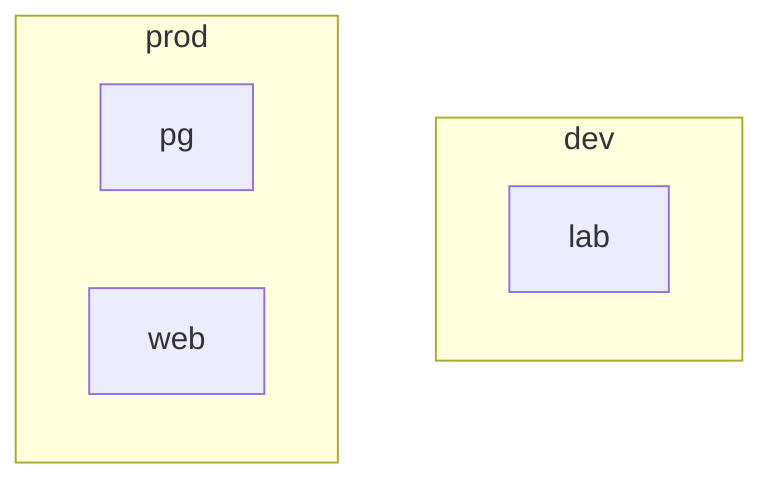
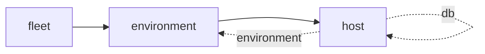
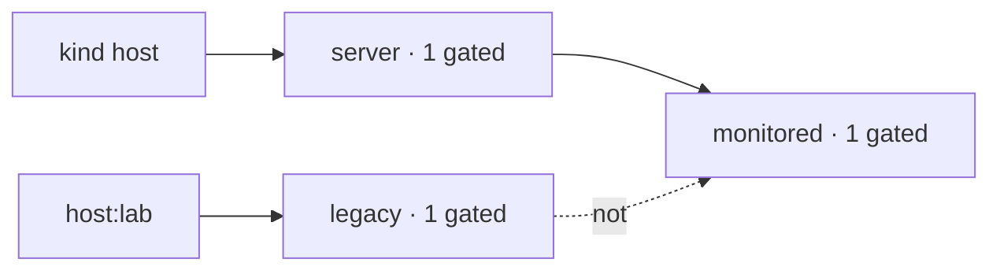
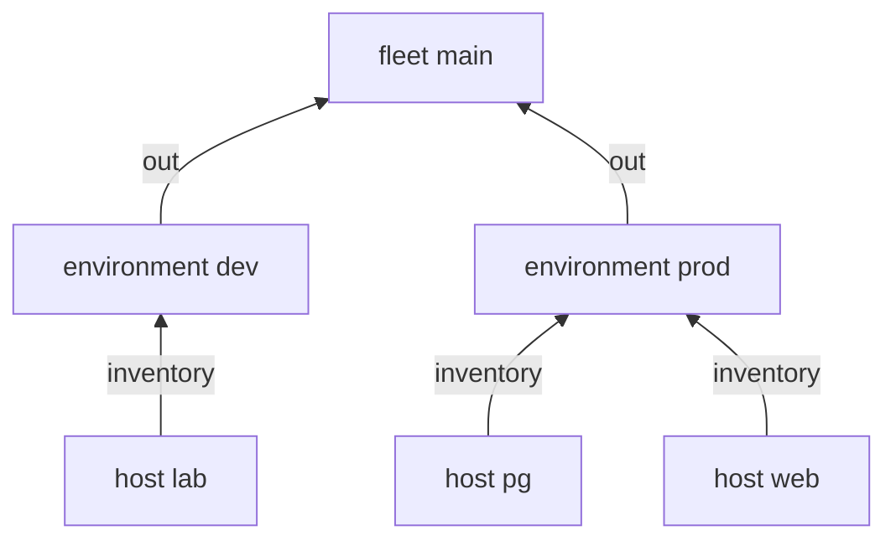
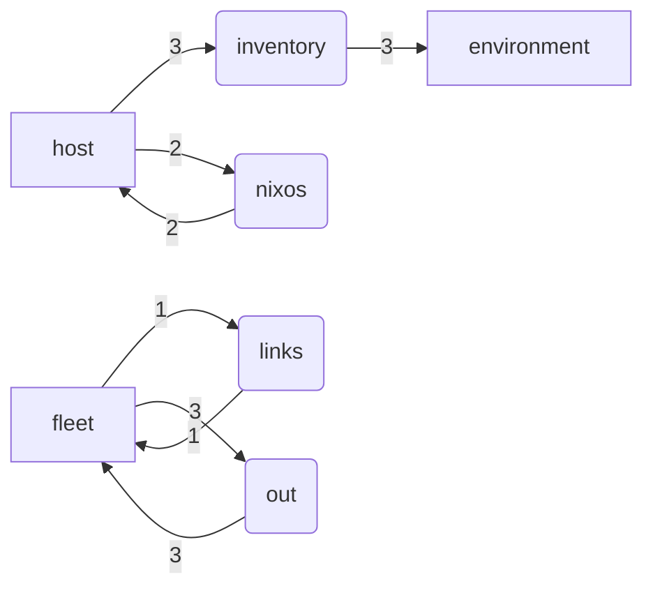
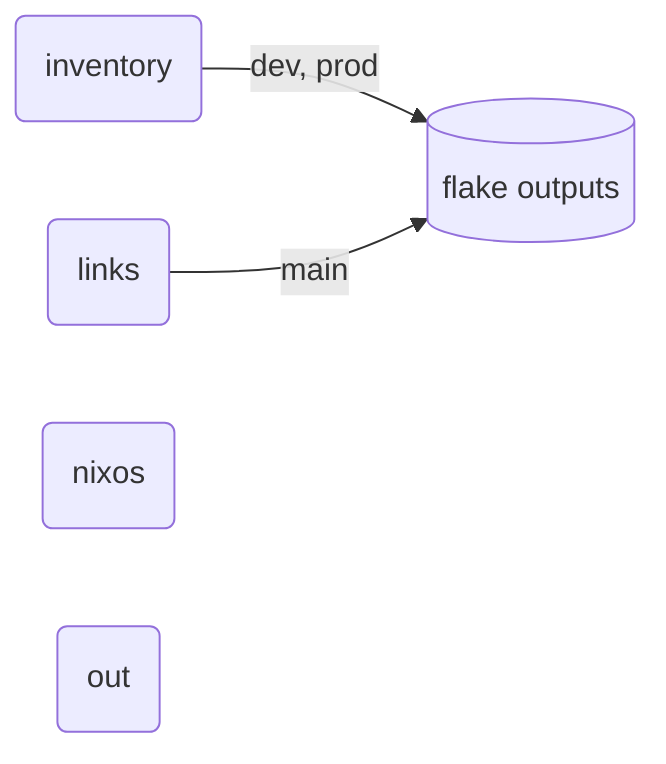

---
{"description":"mermaid views of scopes, kinds, gates and routes; tables, links that follow edits, doc lines checked against live names.","editUrl":"https://github.com/vic/yen/blob/main/docs/examples/batteries-diagrams/page.nix","title":"Diagram and docs batteries"}
---

import { Aside, Badge, Card, CardGrid, FileTree, LinkButton, LinkCard, Steps, TabItem, Tabs } from '@astrojs/starlight/components';

Docs drift when they are written by hand. These batteries make them from the fleet itself: a renamed kind, a new
host or a moved line shows up in the next `nix run .#write-files`, or fails the eval.

| Battery | Gives |
|---|---|
| `mermaid.flowchart { direction; shapes; } view` | the text of a flowchart; a node that others name as `group` is a subgraph |
| `mermaid.scopes { keep; label; group; edge; } graph` | a view of the scopes, each under its parent |
| `mermaid.routes graph`, `mermaid.routing graph` | who gives what to whom; at kind level with counts |
| `mermaid.kinds kinds`, `mermaid.sinks lib` | spawns and ref fields; sinks that give to sinks and to flake outputs |
| `mermaid.gates aspects` | the aspects other aspects name in `at`, and what each reads (dashed under `not`) |
| `docs.table head rows`, `docs.kinds kinds graph` | markdown tables |
| `docs.links { root; base; }` | a reduce: links to the first line that contains a needle; a gone needle is an error |
| `docs.vocabulary { what; names; lines; }` | errors: a live name with no doc line, a doc line with no live name |
| `docs.templates { root; description; }` | flake templates from the directories that have a flake.nix (these docs use it) |

A view is plain data, `{ nodes; edges; }`: make your own from anything and give it to `flowchart`.


```nix title="modules/fleet.nix"
# A small fleet to draw: environments hold hosts; a host may refer to its database host.
{ yen, lib, ... }:
let
  inherit (yen.lib) all not maybe;
in
{
  yen.kinds.fleet = {
    spawns.environment = _: yen.environment;
    sinks.out.reduce = yen.lib.reduce.merge;
  };
  yen.kinds.environment = {
    spawns.host = s: lib.filterAttrs (_: h: yen.lib.same h.environment s) yen.host;
    # hosts report to their environment
    sinks.inventory.out =
      { scope, sinks, ... }:
      {
        inventory.${scope.name} = sinks.inventory;
      };
  };
  yen.kinds.host = {
    fields = {
      environment = yen.kinds.environment;
      db = maybe yen.kinds.host;
    };
    sinks.nixos = { };
  };
  yen.fleet.main = { };
  yen.environment = {
    prod = { };
    dev = { };
  };
  yen.host = {
    web.environment = yen.environment.prod;
    pg.environment = yen.environment.prod;
    lab = {
      environment = yen.environment.dev;
      db = yen.host.pg;
    };
  };
  yen.aspects = {
    server = {
      at = yen.kinds.host;
      inventory = { host, ... }: host.name;
    };
    legacy.at = yen.host.lab;
    monitored = {
      at = all [
        yen.aspects.server
        (not yen.aspects.legacy)
      ];
      nixos.services.prometheus.exporters.node.enable = true;
    };
    alerts.at = yen.aspects.monitored; # names monitored: monitored is a gate, and the diagram shows what it reads
  };
  yen.flake = { out, ... }: out;
}
```

```nix title="modules/diagrams.nix"
# Diagrams of the fleet: every view is data ({ nodes; edges; }), flowchart renders it.
{ yen, ... }:
let
  whole.graph = true; # a tree request: the whole fleet
  inherit (yen.lib.batteries) mermaid;
  draw = direction: view: mermaid.flowchart { inherit direction; } view;
in
{
  yen.aspects.diagrams = {
    at = yen.fleet.main;
    cycle =
      { tree, ... }:
      let
        yen = builtins.head (tree.select whole); # the whole fleet, with its data
      in
      {
        tree = [ whole ];
        out = [
          {
            diagrams = {
              # each environment as a subgraph around its hosts
              scopes = draw "TD" (
                mermaid.scopes {
                  keep = s: !(yen.lib.holds yen.kinds.fleet s);
                  label = s: s.name;
                  group = s: if yen.lib.holds yen.kinds.host s then dirOf s.id else null; # hosts inside their environment (the parent id)
                } yen.lib.graph
              );
              kinds = draw "LR" (mermaid.kinds yen.kinds);
              gates = draw "LR" (mermaid.gates yen.aspects);
              routes = draw "BT" (mermaid.routes yen.lib.graph);
              # kind level: kind -> sink -> kind, counted; sinks as rounded nodes, outputs as cylinders
              routing = mermaid.flowchart {
                shapes = with mermaid.shapes; {
                  sink = round;
                };
              } (mermaid.routing yen.lib.graph);
              sinks = mermaid.flowchart {
                shapes = with mermaid.shapes; {
                  sink = round;
                  output = cylinder;
                };
              } (mermaid.sinks yen.lib);
            };
          }
        ];
      };
  };
}
```

## Scopes, grouped by environment




## Kinds

A dotted edge is a field that refers to a kind.




## Gates

`monitored` reads `server`, and `legacy` under a `not`.




## Routes




## Routing by kind, and sinks






## Tables, links and a vocabulary


```nix title="modules/docs.nix"
# Docs that follow the fleet: a kinds table, links to the line that defines a thing, a doc line for every kind.
{ yen, ... }:
let
  inherit (yen.lib.batteries) docs;
  whole.graph = true; # a tree request: the whole fleet
in
{
  yen.kinds.fleet.sinks.links = {
    reduce = docs.links { root = ./.; };
    out =
      { sinks, ... }:
      {
        links = sinks.links;
      };
  };
  yen.aspects.docs = {
    at = yen.fleet.main;
    links = {
      name = "db-field";
      file = "fleet.nix";
      needle = "db = maybe";
      text = "db";
    };
    cycle =
      { tree, ... }:
      let
        yen = builtins.head (tree.select whole); # the whole fleet, with its data
      in
      {
        tree = [ whole ];
        out = [
          {
            kinds = docs.kinds yen.kinds yen.lib.graph;
            # any table: the hosts and their environment
            hosts = docs.table [ "Host" "Environment" ] (
              map (h: [
                h
                yen.host.${h}.environment.name
              ]) (builtins.attrNames yen.host)
            );
          }
        ];
      };
    # flake templates from the directories under templates/ that have a flake.nix
    out.templates = builtins.mapAttrs (_: t: t.description) (
      docs.templates {
        root = ../templates;
        description = d: (import (d + "/flake.nix")).description;
      }
    );
    # a kind with no line here, or a line for a kind that is gone, is an error
    errors = docs.vocabulary {
      what = "kinds";
      names = builtins.attrNames yen.kinds;
      lines = {
        fleet = "the root";
        environment = "where hosts run";
        host = "a NixOS machine";
      };
    };
  };
}
```

| Kind | Fields | Spawns | Sinks | Scopes |
|---|---|---|---|---|
| `environment` |  | `host` | `inventory` | 2 |
| `fleet` |  | `environment` | `links`, `out` | 1 |
| `host` | `db`, `environment` |  | `nixos` | 3 |


| Host | Environment |
|---|---|
| lab | dev |
| pg | prod |
| web | prod |

```nix title="result"
{
  hello = "hello: the smallest flake";
}
```


The link follows the line: `[`db`](fleet.nix#L23)`. A new kind with no doc line fails:


```nix title="result"
[
  {
    code = "doc-missing";
    error = "kinds `cluster`: a live name with no doc line";
  }
]
```

:::tip[Run this example]
Every block on this page is a file of the template `batteries-diagrams`. Copy it and run it:

```sh frame="terminal"
nix flake init -t github:vic/yen#batteries-diagrams
```

<FileTree>

- flake.nix
- modules/
  - diagrams.nix
  - docs.nix
  - fleet.nix
- templates/
  - hello/
    - flake.nix
- variants/
  - new-kind.nix

</FileTree>
:::
