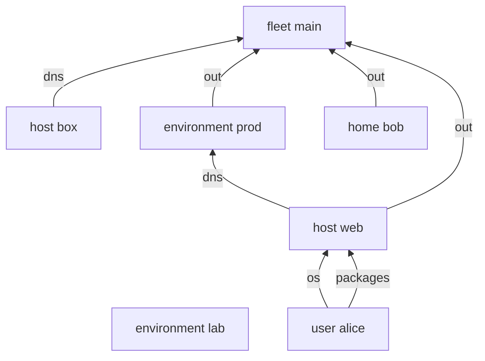

---
{"description":"An element goes up to the nearest scope that has the sink and where the sink's `at` holds.","editUrl":"https://github.com/vic/yen/blob/main/docs/examples/routing/page.nix","title":"Routing and walls"}
---

import { Aside, Badge, Card, CardGrid, FileTree, LinkButton, LinkCard, Steps, TabItem, Tabs } from '@astrojs/starlight/components';

An aspect does not say who receives its elements. The tree does. An element goes to the nearest
ancestor-or-self scope that has the sink, and where the sink's `at` holds.

This example has a fleet, two environments, two hosts, a user and a home:


```nix title="modules/fleet.nix" {17,23}
# fleet > environment > host > user and home. Who receives an element depends on where the sinks are.
{ yen, lib, ... }:
let
  inherit (yen.lib) same opt;
  under =
    field: kind: s:
    lib.filterAttrs (_: x: same x.${field} s) kind;
in
{
  yen.kinds.fleet = {
    spawns.environment = _: yen.environment;
    sinks.out.reduce = yen.lib.reduce.merge;
    sinks.dns.out =
      { dns, ... }:
      {
        dns.fleet = dns;
      }; # the fallback receiver
  };
  yen.kinds.environment = {
    fields.public = opt lib.types.bool false;
    spawns.host = under "environment" yen.host;
    sinks.dns = {
      at = s: s.public; # a conditional receiver: only public environments
      out =
        { environment, dns, ... }:
        {
          dns.${environment.name} = dns;
        };
    };
  };
  yen.kinds.host = {
    fields.environment = yen.kinds.environment;
    spawns = {
      user = under "on" yen.user;
      home = under "on" yen.home;
    };
    sinks.os.out =
      { host, os, ... }:
      {
        os.${host.name} = os;
      };
  };
  yen.kinds.user.fields.on = yen.kinds.host;
  yen.kinds.home = {
    fields.on = yen.kinds.host;
    sinks.os.out =
      { home, os, ... }:
      {
        os.${home.name} = os;
      }; # a home builds its own config
  };

  yen.fleet.main = { };
  yen.flake = { out, ... }: out;
}
```

```nix title="modules/instances.nix"
{ yen, ... }:
{
  yen.environment.prod.public = true;
  yen.environment.lab = { };
  yen.host.web.environment = yen.environment.prod;
  yen.host.box.environment = yen.environment.lab;
  yen.user.alice.on = yen.host.web;
  yen.home.bob.on = yen.host.web;
}
```

```nix title="modules/aspects.nix"
{ yen, ... }:
{
  yen.aspects.accounts = {
    at = [
      yen.kinds.user
      yen.kinds.home
    ];
    os = { scope, ... }: "account ${scope.name}";
  };
  yen.aspects.records = {
    at = yen.kinds.host;
    dns = { host, ... }: "${host.name} A";
  };
}
```

```nix title="result"
{
  dns = {
    fleet = [
      "box A"
    ];
    prod = [
      "web A"
    ];
  };
  os = {
    bob = [
      "account bob"
    ];
    web = [
      "account alice"
    ];
  };
  packages = {
    web = [
      "vim for alice"
    ];
  };
}
```

| Element | Given at | Received at | Why |
|---|---|---|---|
| `os` | user `alice` | host `web` | a user has no `os` sink; the host above has one |
| `os` | home `bob` | home `bob` | the home has its own `os` sink: ancestor-or-self |
| `dns` | host `web` | environment `prod` | `prod` is public, so its `dns` sink holds |
| `dns` | host `box` | fleet `main` | `lab` is not public; the next receiver is the fleet |

The routes, drawn from `result.graph.edges`:




## Walls

A sink with no keys is a wall. It receives elements and gives nothing on. A home under a host
can keep its packages away from the host:


```nix title="modules/walls.nix"
# A sink with no keys is a wall: a home's packages stop at the home and never reach the host.
{ yen, ... }:
{
  yen.kinds.host.sinks.packages.out =
    { host, packages, ... }:
    {
      packages.${host.name} = packages;
    };
  yen.kinds.home.sinks.packages = { };
  yen.aspects.editor = {
    at = [
      yen.kinds.user
      yen.kinds.home
    ];
    packages = { scope, ... }: "vim for ${scope.name}";
  };
}
```

`result.reduced.packages` shows both receivers. Only the host gives its packages to the flake:


```nix title="result"
{
  "fleet:main/environment:prod/host:web" = [
    "vim for alice"
  ];
  "fleet:main/environment:prod/host:web/home:bob" = [
    "vim for bob"
  ];
}
```

:::note[A sink nobody reads]
A sink that nobody reads is not an error. Nothing happens. Laziness means it costs nothing either.
:::

:::tip[Run this example]
Every block on this page is a file of the template `routing`. Copy it and run it:

```sh frame="terminal"
nix flake init -t github:vic/yen#routing
```

<FileTree>

- flake.nix
- modules/
  - aspects.nix
  - fleet.nix
  - instances.nix
  - walls.nix

</FileTree>
:::
