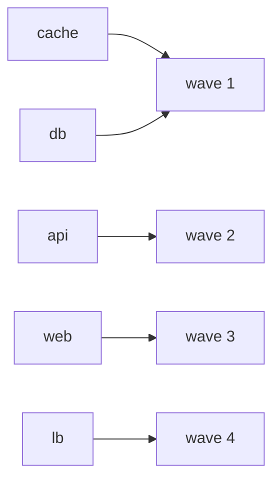

import { Aside, Badge, Card, CardGrid, FileTree, LinkButton, LinkCard, Steps, TabItem, Tabs } from '@astrojs/starlight/components';

Fleet data is plain Nix, so a question about it is a function. `yen.lib.graphs` answers graph questions.
It works on `succ`, an attrset from a node to its successors, or on `of nodes next`, a graph over instances whose
answers are refs `{ kind; name; }`: a host is never named by a string. Every function sorts, so the order the data is
written in never changes an answer.


| Function | Answer |
|---|---|
| `reach succ n` | every node reachable from `n` |
| `reachers succ n` | every node that reaches `n` |
| `transpose succ` | the edges reversed |
| `topo succ` | a topological order, or `{ ok = false; stuck; }` for a cycle |
| `layers succ` | waves: each node after its successors |
| `sccs succ`, `cycles succ` | strongly connected components, nodes on a cycle |
| `shortest succ a b`, `paths succ a b` | the shortest path, all paths |
| `of nodes next` | a graph over instances: every function above takes it, and answers with refs |
| `fromEdges es` | `succ` from `[ { from; to; } ]` |

Hosts depend on hosts:


```nix title="modules/fleet.nix"
{ yen, lib, ... }:
{
  yen.kinds.fleet = {
    spawns.host = _: yen.host;
    sinks.out.reduce = yen.lib.reduce.merge;
  };
  yen.kinds.host.fields.dependsOn = yen.lib.opt (yen.lib.is lib.isList) [ ]; # host refs

  yen.fleet.main = { };
  yen.host.db = { };
  yen.host.cache = { };
  yen.host.api = {
    dependsOn = [
      yen.host.db
      yen.host.cache
    ];
  };
  yen.host.web = {
    dependsOn = [ yen.host.api ];
  };
  yen.host.lb = {
    dependsOn = [ yen.host.web ];
  };
  yen.flake = { out, ... }: out;
}
```

```nix title="modules/deploy.nix"
# `G.of nodes next`: a graph over instances. Here: every host, and the hosts it depends on. Answers are refs.
{ yen, lib, ... }:
let
  G = yen.lib.graphs;
  all.instances = yen.kinds.host; # a tree request: every host, with its data
  names = map (h: h.name);
in
{
  yen.aspects.deploy-plan = {
    at = yen.kinds.fleet;
    cycle =
      { tree, ... }:
      let
        hosts = lib.head (tree.select all);
        g = G.of hosts (h: h.dependsOn);
      in
      {
        tree = [ all ];
        out = [
          {
            deploy = {
              waves = map names (G.layers g); # dependencies first: each wave after the waves it depends on
              impact = lib.listToAttrs (map (h: lib.nameValuePair h.name (names (G.reachers g h))) hosts); # who breaks if this host is down
              path = names (G.shortest g yen.host.lb yen.host.db);
            };
          }
        ];
        errors = [
          (map (c: "deploy: a dependency cycle: ${lib.concatStringsSep " -> " (names c)}") (
            lib.filter (c: lib.length c > 1) (G.sccs g)
          ))
        ]; # one element: the list, as before
      };
  };
}
```

```nix title="result"
{
  impact = {
    api = [
      "lb"
      "web"
    ];
    cache = [
      "api"
      "lb"
      "web"
    ];
    db = [
      "api"
      "lb"
      "web"
    ];
    lb = [ ];
    web = [
      "lb"
    ];
  };
  path = [
    "lb"
    "web"
    "api"
    "db"
  ];
  waves = [
    [
      "cache"
      "db"
    ]
    [
      "api"
    ]
    [
      "web"
    ]
    [
      "lb"
    ]
  ];
}
```

The deploy waves as a diagram, from the same data:




## A cycle is an error

A cycle is data, not a hang. `sccs` finds it, and the aspect gives an error record:


```nix title="variants/cycle.nix"
# db now depends on lb: a cycle.
{ yen, ... }:
{
  yen.host.db.dependsOn = [ yen.host.lb ];
}
```

```nix title="result"
[
  "deploy: a dependency cycle: api -> db -> lb -> web"
]
```

:::tip[Run this example]
Every block on this page is a file of the template `graphs`. Copy it and run it:

```sh frame="terminal"
nix flake init -t github:vic/yen#graphs
```

<FileTree>

- flake.nix
- modules/
  - deploy.nix
  - fleet.nix
- variants/
  - cycle.nix

</FileTree>
:::
