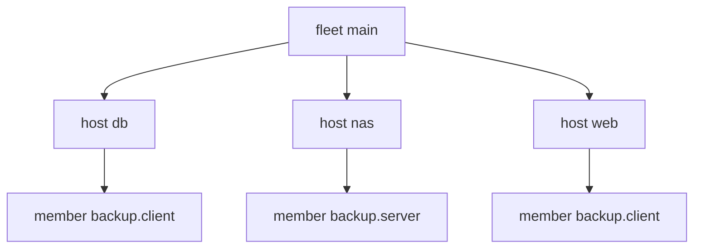

import { Aside, Badge, Card, CardGrid, FileTree, LinkButton, LinkCard, Steps, TabItem, Tabs } from '@astrojs/starlight/components';

A backup has roles: one server, many clients. An assembly says which machine takes which role, with refs.


```nix title="modules/inventory.nix"
{ yen, ... }:
{
  yen.host.nas.addr = "10.0.0.10";
  yen.host.web.addr = "10.0.0.1";
  yen.host.db.addr = "10.0.0.2";
  yen.assembly.backup.roles = {
    server = [ yen.host.nas ];
    client = [
      yen.host.web
      yen.host.db
    ];
  };
}
```

Each machine spawns one `member` scope per (assembly, role) it takes part in. The member holds a ref to its
assembly. An aspect at a member scope runs once per assembly and role. An aspect at a machine that `has` a
member runs once per machine.


```nix title="modules/kinds.nix" {12-15,33}
# An assembly is data: which machines take which role. Each machine spawns one `member` scope per role it has.
{ yen, lib, ... }:
let
  inherit (yen.lib) same is;
  membersOf =
    m:
    lib.listToAttrs (
      lib.concatMap (
        a:
        lib.concatMap (
          role:
          lib.optional (lib.any (same m) a.roles.${role}) (
            lib.nameValuePair "${a.name}.${role}" {
              assembly = a;
              inherit role;
            }
          )
        ) (lib.attrNames a.roles)
      ) (lib.attrValues yen.assembly)
    );
in
{
  yen.kinds.fleet = {
    spawns.host = _: yen.host;
    sinks = {
      out.reduce = yen.lib.reduce.merge;
      exports.reduce = yen.lib.reduce.entries; # what members publish, with the scope that published it
    };
  };
  yen.kinds.assembly.fields.roles = is lib.isAttrs; # role name -> host refs
  yen.kinds.host = {
    fields.addr = lib.types.str;
    spawns.member = membersOf;
    sinks.config = {
      reduce = yen.lib.reduce.merge;
      out =
        { host, config, ... }:
        {
          config.${host.name} = config;
        };
    };
  };
  yen.kinds.member = { }; # its elements go up to its machine

  yen.fleet.main = { };
  yen.flake = { out, ... }: out;
}
```



## Members exchange data

Clients publish their address to a fleet sink with `entries`. The engine sets `from`, so a member can only publish
as itself. The server reads the entries and builds its allow list:


```nix title="modules/backup.nix" {9,15}
# The backup: an aspect per role, at member scopes. Clients export their address; the server reads them.
{ yen, lib, ... }:
let
  inherit (yen.lib) same;
  role =
    r:
    yen.lib.all [
      yen.kinds.member
      (s: same s.assembly yen.assembly.backup && s.role == r)
    ];
in
{
  yen.aspects.backup-client = {
    at = role "client";
    exports = { host, ... }: host.addr; # published by the member scope: the engine sets `from`
    cycle =
      { tree, ... }:
      let
        nas.scopesOf = yen.host.nas; # a tree request: nas, with its data
        me.nearest = yen.kinds.host; # a tree request: the host this member sits on
      in
      {
        tree = [
          nas
          me
        ];
        config = [
          {
            backup.target = (lib.head (lib.head (tree.select nas))).addr;
            backup.name = (lib.head (tree.select me)).name;
          }
        ];
      };
  };
  yen.aspects.backup-server = {
    at = role "server";
    config =
      { exports, ... }:
      {
        backup.allow = lib.sort (a: b: a < b) (
          map (e: e.value) (lib.filter (e: yen.lib.holds yen.kinds.member e.from) exports)
        );
      };
  };
  # once per machine that takes part in any role of the assembly
  yen.aspects.backup-tools = {
    at = yen.lib.has (s: yen.lib.holds yen.kinds.member s && same s.assembly yen.assembly.backup);
    config.packages = [ "borgbackup" ];
  };
}
```

```nix title="result"
{
  db = {
    backup = {
      name = "db";
      target = "10.0.0.10";
    };
    packages = [
      "borgbackup"
    ];
  };
  nas = {
    backup = {
      allow = [
        "10.0.0.1"
        "10.0.0.2"
      ];
    };
    packages = [
      "borgbackup"
    ];
  };
  web = {
    backup = {
      name = "web";
      target = "10.0.0.10";
    };
    packages = [
      "borgbackup"
    ];
  };
}
```

:::tip[The full model]
[Kits batteries](/batteries/kits/) add kits as data with typed role settings and errors, `at` predicates as
role members, exports with owner overrides, and vars generators. The
[reference fleet](https://github.com/vic/yen/blob/main/templates/fleet/modules/kits/assemblies.nix) uses them.
:::

:::tip[Run this example]
Every block on this page is a file of the template `assemblies`. Copy it and run it:

```sh frame="terminal"
nix flake init -t github:vic/yen#assemblies
```

<FileTree>

- flake.nix
- modules/
  - backup.nix
  - inventory.nix
  - kinds.nix

</FileTree>
:::
