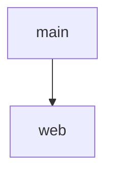

import { Aside, Badge, Card, CardGrid, FileTree, LinkButton, LinkCard, Steps, TabItem, Tabs } from '@astrojs/starlight/components';

Some repo files are views of your fleet: the flake's inputs, a README with the host diagram, a CI workflow.
Write them from the data, and a check fails when a committed file is stale.
[denful/flake-file](https://github.com/denful/flake-file) writes `flake.nix`.
[sini/files](https://github.com/sini/files) writes `README.md` and the CI workflow. sven gives both the content.

These docs are made this way: every page you read is a file that the docs fleet writes. So is sven's CI workflow:
each stage is an aspect, and one job per system comes from the reference fleet's `ci.json`
([docs/modules/ci.nix](https://github.com/vic/sven/blob/main/docs/modules/ci.nix)).


```nix title="modules/fleet.nix" {17-36}
# The fleet writes its own repo files. `flake-file` collects github:denful/flake-file options (flake.nix);
# `files` collects github:sini/files modules (README.md, CI workflow).
{
  sven,
  lib,
  inputs,
  ...
}:
let
  pkgs = inputs.nixpkgs.legacyPackages.x86_64-linux;
in
{
  sven.kinds.fleet = {
    spawns.host = _: sven.host;
    sinks = {
      out.reduce = sven.lib.reduce.merge;
      flake-file = {
        reduce = sven.lib.reduce.merge; # flake inputs, declared by the aspects that use them
        out =
          { flake-file, ... }:
          let
            e = inputs.nixpkgs-unstable.lib.evalModules {
              # flake-file needs `valueMeta` on submodule options: nixos-25.05 lib lacks it
              specialArgs = { inherit inputs; };
              modules = [
                inputs.flake-file.flakeModules.flake
                { inherit flake-file; }
                { flake-file.formatter = p: p.nixfmt-rfc-style; }
              ];
            };
          in
          {
            packages.x86_64-linux.write-flake = e.config.flake-file.apps.write-flake pkgs;
            checks.x86_64-linux.flake-file = e.config.flake-file.check-flake-file pkgs;
          };
      };
      files.out =
        { files, ... }:
        let
          e = lib.evalModules {
            modules = [
              inputs.files.module
              {
                _module.args.pkgs = pkgs;
                files.root = inputs.self;
                files.relativeRoot = "docs/examples/generated-files";
              }
            ]
            ++ files;
          };
        in
        {
          packages.x86_64-linux.write-files = e.config.files.writer.drv;
          checks.x86_64-linux = e.config.files.checks; # each committed file must match
        };
    };
  };
  sven.kinds.host.sinks.nixos.out =
    { host, nixos, ... }:
    {
      nixosConfigurations.${host.name} = inputs.nixpkgs.lib.nixosSystem { modules = nixos; };
    };

  sven.fleet.main = { };
  sven.host.web = { };
  sven.flake = { out, ... }: out;
}
```

## Inputs live with their users

Each aspect declares the flake inputs it uses on the `flake-file` sink. The host's input goes up to the fleet:


```nix title="modules/inputs.nix" {29}
# Each feature declares the inputs it uses, next to the code that uses them.
{ sven, ... }:
{
  sven.aspects.core-inputs = {
    at = sven.kinds.fleet;
    flake-file = {
      description = "A fleet that writes its own flake.nix, README.md and CI workflow";
      outputs = ''
        inputs:
        inputs.sven.lib.mkFlake {
          imports = [ (inputs.import-tree ./modules) ];
          _module.args = {
            inherit inputs;
            inherit (inputs.nixpkgs) lib;
          };
        }
      '';
      inputs = {
        sven.url = "github:vic/sven";
        import-tree.url = "github:denful/import-tree";
        flake-file.url = "github:denful/flake-file";
        files.url = "github:sini/files";
        nixpkgs-unstable.url = "github:nixos/nixpkgs/nixpkgs-unstable"; # flake-file's lib
      };
    };
  };
  sven.aspects.web = {
    at = sven.host.web;
    flake-file.inputs.nixpkgs.url = "https://nixos.org/channels/nixos-25.05/nixexprs.tar.xz"; # goes up to the fleet's `flake-file` sink
    nixos = {
      services.nginx.enable = true;
      boot.loader.grub.device = "nodev";
      fileSystems."/" = {
        device = "/dev/sda1";
        fsType = "ext4";
      };
      nixpkgs.hostPlatform = "x86_64-linux";
      system.stateVersion = "25.05";
    };
  };
}
```

## README and CI workflow

The `files` sink collects `sini/files` modules. One aspect writes the README, with a single mermaid diagram of the fleet's hosts, and the CI workflow:


```nix title="modules/write.nix"
# README.md and the CI workflow, generated from fleet data by github:sini/files.
{ sven, lib, ... }:
let
  hosts = lib.filter (s: s.kind == "host") sven.lib.graph.scopes;
in
{
  sven.aspects.write = {
    at = sven.kinds.fleet;
    files = {
      files.file."README.md".text = ''
        # My fleet

        Generated from the fleet. Hosts: ${lib.concatMapStringsSep ", " (s: "`${s.name}`") hosts}.

        ```mermaid
        graph TD
          fleet[main]
        ${lib.concatMapStringsSep "\n" (s: "  fleet --> ${s.name}") hosts}
        ```
      '';
      files.file.".github/workflows/ci.yml".text = ''
        name: ci
        on: [push, pull_request]
        jobs:
          check:
            runs-on: ubuntu-latest
            steps:
              - uses: actions/checkout@v4
              - uses: DeterminateSystems/nix-installer-action@main
              - run: nix flake check
      '';
    };
  };
}
```

The template's own `flake.nix` is the `flake-file` output. Remove the `web` aspect, and `nixpkgs` leaves the flake.


```nix title="flake.nix"
# DO-NOT-EDIT. This file was auto-generated using github:denful/flake-file.
# Use `nix run .#write-flake` to regenerate it.
{
  description = "A fleet that writes its own flake.nix, README.md and CI workflow";

  outputs =
    inputs:
    inputs.sven.lib.mkFlake {
      imports = [ (inputs.import-tree ./modules) ];
      _module.args = {
        inherit inputs;
        inherit (inputs.nixpkgs) lib;
      };
    };

  inputs = {
    files.url = "github:sini/files";
    flake-file.url = "github:denful/flake-file";
    import-tree.url = "github:denful/import-tree";
    nixpkgs.url = "https://nixos.org/channels/nixos-25.05/nixexprs.tar.xz";
    nixpkgs-unstable.url = "github:nixos/nixpkgs/nixpkgs-unstable";
    sven.url = "github:vic/sven";
  };
}
```

```md title="README.md"
# My fleet

Generated from the fleet. Hosts: `web`.


```

```text title=".github/workflows/ci.yml"
name: ci
on: [push, pull_request]
jobs:
  check:
    runs-on: ubuntu-latest
    steps:
      - uses: actions/checkout@v4
      - uses: DeterminateSystems/nix-installer-action@main
      - run: nix flake check
```

```sh frame="terminal"
nix run .#write-flake   # write flake.nix
nix run .#write-files   # write README.md and the CI workflow
nix flake check         # fails when a committed file is stale
```

:::tip[Run this example]
Every block on this page is a file of the template `generated-files`. Copy it and run it:

```sh frame="terminal"
nix flake init -t github:vic/sven#generated-files
```

<FileTree>

- .github/
  - workflows/
    - ci.yml
- README.md
- flake.lock
- flake.nix
- modules/
  - fleet.nix
  - inputs.nix
  - write.nix

</FileTree>
:::
