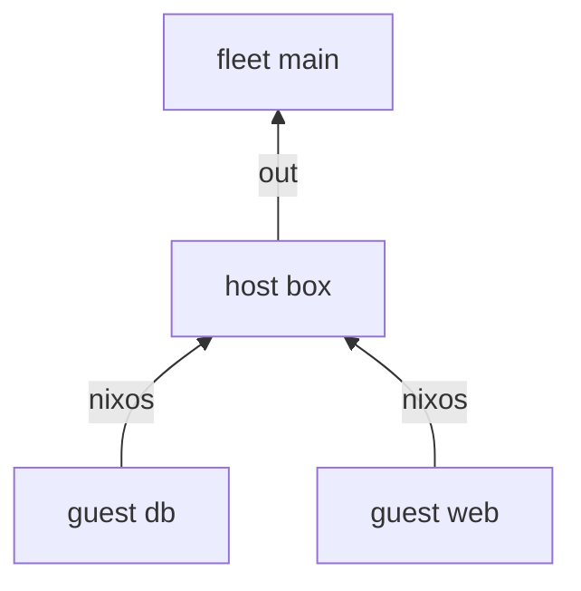

---
{"description":"Containers or VMs as scopes under their host. A guest's NixOS goes into the host, never the other way.","editUrl":"https://github.com/vic/yen/blob/main/docs/examples/guests/page.nix","title":"Guests inside hosts"}
---

import { Aside, Badge, Card, CardGrid, FileTree, LinkButton, LinkCard, Steps, TabItem, Tabs } from '@astrojs/starlight/components';

A guest is a machine that runs inside a host: a NixOS container here, a microvm in the
[reference fleet](https://github.com/vic/yen/blob/main/templates/fleet/modules/platforms/microvm.nix).
It is a scope under its host, with its own `nixos` sink. That sink forwards its modules up, into the host.


```nix title="modules/kinds.nix" {23-24}
# A guest lives under its host. Its own `nixos` sink forwards up, into the host's containers.
{
  yen,
  lib,
  inputs,
  ...
}:
{
  yen.kinds.fleet = {
    spawns.host = _: yen.host;
    sinks.out.reduce = yen.lib.reduce.merge;
  };
  yen.kinds.host = {
    spawns.guest = s: lib.filterAttrs (_: g: yen.lib.same g.on s) yen.guest;
    sinks.nixos.out =
      { host, nixos, ... }:
      {
        nixosConfigurations.${host.name} = inputs.nixpkgs.lib.nixosSystem { modules = nixos; };
      };
  };
  yen.kinds.guest = {
    fields.on = yen.kinds.host;
    sinks.nixos.nixos =
      { guest, nixos, ... }:
      {
        containers.${guest.name} = {
          autoStart = true;
          config.imports = nixos;
        };
      };
  };

  yen.fleet.main = { };
  yen.flake = { out, ... }: out;
}
```

```nix title="modules/machines.nix"
{ yen, ... }:
{
  yen.host.box = { };
  yen.guest.web.on = yen.host.box;
  yen.guest.db.on = yen.host.box;

  yen.aspects.box = {
    at = yen.host.box;
    nixos = {
      boot.loader.grub.device = "nodev";
      fileSystems."/" = {
        device = "/dev/sda1";
        fsType = "ext4";
      };
      nixpkgs.hostPlatform = "x86_64-linux";
      system.stateVersion = "25.05";
    };
  };
}
```

```nix title="modules/services.nix"
# Aspects at guests. None of this reaches the host's own system: an element goes to its nearest `nixos` sink.
{ yen, ... }:
{
  yen.aspects.guest-base = {
    at = yen.kinds.guest;
    nixos =
      { guest, ... }:
      {
        networking.hostName = guest.name;
        system.stateVersion = "25.05";
      };
  };
  yen.aspects.nginx = {
    at = yen.guest.web;
    nixos.services.nginx.enable = true;
  };
  yen.aspects.postgres = {
    at = yen.guest.db;
    nixos.services.postgresql.enable = true;
  };
}
```



`nginx` runs in the `web` container. The host `box` does not get it: the element went to `web`'s own sink.


:::caution[Content flows up only]
A host aspect never reaches its guests. To give every guest something, write an aspect with `at = yen.kinds.guest`,
or `within` a host.
:::

```sh frame="terminal"
sudo nixos-rebuild switch --flake .#box   # builds box and both containers
```

:::tip[Run this example]
Every block on this page is a file of the template `guests`. Copy it and run it:

```sh frame="terminal"
nix flake init -t github:vic/yen#guests
```

<FileTree>

- flake.nix
- modules/
  - kinds.nix
  - machines.nix
  - services.nix

</FileTree>
:::
