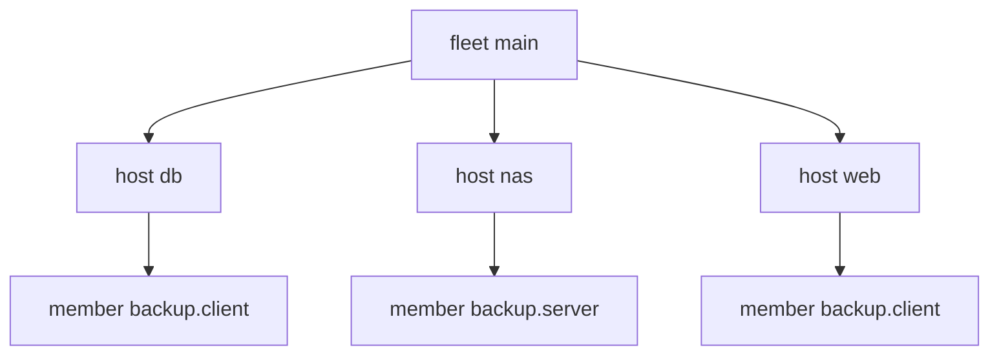

import { Aside, Badge, Card, CardGrid, FileTree, LinkButton, LinkCard, Steps, TabItem, Tabs } from '@astrojs/starlight/components';

A service such as backup has roles: one server, many clients. The instance says which machine takes which role.
This is [clan](https://clan.lol)'s inventory model, in plain yen.


```nix title="modules/inventory.nix"
{ yen, ... }:
{
  yen.host.nas.addr = "10.0.0.10";
  yen.host.web.addr = "10.0.0.1";
  yen.host.db.addr = "10.0.0.2";
  yen.instance.backup.roles = {
    server = [ yen.host.nas ];
    client = [
      yen.host.web
      yen.host.db
    ];
  };
}
```

Each machine spawns one `member` scope per (instance, role) it takes part in. An aspect at a member scope runs once
per instance (clan's `perInstance`). An aspect at a machine that `has` a member runs once per machine (`perMachine`).


```nix title="modules/kinds.nix" {5-7,35}
# A service instance is data: which machines take which role. Each machine spawns one `member` scope per role it has.
{ yen, lib, ... }:
let
  inherit (yen.lib) same is;
  membersOf =
    m:
    lib.listToAttrs (
      lib.concatLists (
        lib.mapAttrsToList (
          n: i:
          lib.concatMap (
            role:
            lib.optional (lib.any (same m) i.roles.${role}) (
              lib.nameValuePair "${n}.${role}" {
                instance = n;
                inherit role;
              }
            )
          ) (lib.attrNames i.roles)
        ) yen.instance
      )
    );
in
{
  yen.kinds.fleet = {
    spawns.host = _: yen.host;
    sinks = {
      out.reduce = yen.lib.reduce.merge;
      exports.reduce = yen.lib.reduce.entries; # what members publish, with the scope that published it
    };
  };
  yen.kinds.instance.fields.roles = is lib.isAttrs; # role name -> host refs
  yen.kinds.host = {
    fields.addr = lib.types.str;
    spawns.member = membersOf;
    sinks.config = {
      reduce = yen.lib.reduce.merge;
      out =
        { host, config, ... }:
        {
          config.${host.name} = config;
        };
    };
  };
  yen.kinds.member = { }; # its elements go up to its machine

  yen.fleet.main = { };
  yen.flake = { out, ... }: out;
}
```



## Members exchange data

Clients publish their address to a fleet sink with `entries`. The engine sets `from`, so a member can only publish
as itself. The server reads the entries and builds its allow list:


```nix title="modules/backup.nix" {8,14}
# The service: an aspect per role, at member scopes. Clients export their address; the server reads them.
{ yen, lib, ... }:
let
  role =
    r:
    yen.lib.all [
      yen.kinds.member
      (s: s.instance == "backup" && s.role == r)
    ];
in
{
  yen.aspects.backup-client = {
    at = role "client";
    exports = { host, ... }: host.addr; # published by the member scope: the engine sets `from`
    config =
      { host, ... }:
      {
        backup.target = yen.host.nas.addr;
        backup.name = host.name;
      };
  };
  yen.aspects.backup-server = {
    at = role "server";
    config =
      { exports, ... }:
      {
        backup.allow = lib.sort (a: b: a < b) (
          map (e: e.value) (lib.filter (e: yen.lib.holds yen.kinds.member e.from) exports)
        );
      };
  };
  # once per machine that takes part in any role of the service
  yen.aspects.backup-tools = {
    at = yen.lib.has (s: yen.lib.holds yen.kinds.member s && s.instance == "backup");
    config.packages = [ "borgbackup" ];
  };
}
```

```nix title="result"
{
  db = {
    backup = {
      name = "db";
      target = "10.0.0.10";
    };
    packages = [
      "borgbackup"
    ];
  };
  nas = {
    backup = {
      allow = [
        "10.0.0.1"
        "10.0.0.2"
      ];
    };
    packages = [
      "borgbackup"
    ];
  };
  web = {
    backup = {
      name = "web";
      target = "10.0.0.10";
    };
    packages = [
      "borgbackup"
    ];
  };
}
```

:::tip[The full model]
The [reference fleet](https://github.com/vic/yen/blob/main/templates/fleet/modules/clan/inventory.nix) adds tags as role members,
typed role settings with errors, exports per service with owner overrides, install order, and vars generators.
:::

:::tip[Run this example]
Every block on this page is a file of the template `services`. Copy it and run it:

```sh frame="terminal"
nix flake init -t github:vic/yen#services
```

<FileTree>

- flake.nix
- modules/
  - backup.nix
  - inventory.nix
  - kinds.nix

</FileTree>
:::
