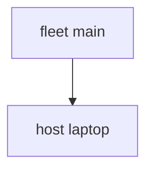

---
{"description":"One NixOS host, from an empty directory, in four files.","editUrl":"https://github.com/vic/sven/blob/main/docs/examples/getting-started/page.nix","title":"Getting started"}
---

import { Aside, Badge, Card, CardGrid, FileTree, LinkButton, LinkCard, Steps, TabItem, Tabs } from '@astrojs/starlight/components';

This page builds one NixOS host with sven. You write four small files. At the end you have a
`nixosConfigurations.laptop` that `nixos-rebuild` can use.


<Steps>

1. Get the template. It has a `flake.nix` and a `modules/` directory.

   ```sh frame="terminal"
   nix flake init -t github:vic/sven#getting-started
   ```

2. Read `flake.nix`. The `sven` input is a normal flake input.
   [import-tree](https://github.com/denful/import-tree) loads every file in `modules/`.

   ```nix title="flake.nix"
   {
     description = "sven: one NixOS host";

     outputs =
       inputs:
       inputs.sven.lib.mkFlake {
         imports = [ (inputs.import-tree ./modules) ];
         _module.args = {
           inherit inputs;
           inherit (inputs.nixpkgs) lib;
         };
       };

     inputs = {
       sven.url = "github:vic/sven";
       import-tree.url = "github:denful/import-tree";
       nixpkgs.url = "https://nixos.org/channels/nixos-25.05/nixexprs.tar.xz";
     };
   }
   ```

3. Build the host:

   ```sh frame="terminal"
   nix build .#nixosConfigurations.laptop.config.system.build.toplevel
   ```

</Steps>

## The fleet

sven has no built-in kinds. You say what a fleet is. The root kind is the one that nothing spawns.
Here the root `fleet` spawns every host, and its `out` sink is the flake.


```nix title="modules/fleet.nix"
# The root of the tree. Nothing spawns it. Its `out` sink is the flake.
{ sven, ... }:
{
  sven.kinds.fleet = {
    spawns.host = _: sven.host; # every host lives under the fleet
    sinks.out.reduce = sven.lib.reduce.merge;
  };
  sven.fleet.main = { };
  sven.flake = { out, ... }: out;
}
```

## The host

A kind has `fields` (the data of each instance) and `sinks` (where behavior goes).
The `nixos` sink collects NixOS modules. Its `out` key gives the built system to the flake.


```nix title="modules/host.nix" {13}
# A host has a system. Its `nixos` sink collects NixOS modules and builds the host.
{
  sven,
  lib,
  inputs,
  ...
}:
{
  sven.kinds.host = {
    fields.system = lib.types.str;
    sinks.nixos.out =
      { host, nixos, ... }:
      {
        nixosConfigurations.${host.name} = inputs.nixpkgs.lib.nixosSystem {
          inherit (host) system;
          modules = nixos;
        };
      };
  };

  sven.host.laptop.system = "x86_64-linux";
}
```

## Behavior

An aspect is active where its `at` holds. Each key of an aspect gives one element to the sink
of that name. `base` is active at every host. `motd` is active at `laptop` only.


```nix title="modules/aspects.nix"
# Behavior: active at every host, gives one NixOS module to the `nixos` sink.
{ sven, ... }:
{
  sven.aspects.base = {
    at = sven.kinds.host;
    nixos =
      { host, ... }:
      {
        networking.hostName = host.name;
        boot.loader.grub.device = "nodev";
        fileSystems."/" = {
          device = "/dev/disk/by-label/nixos";
          fsType = "ext4";
        };
        system.stateVersion = "25.05";
      };
  };

  sven.aspects.motd = {
    at = sven.host.laptop;
    nixos.environment.etc.motd.text = "managed by sven";
  };
}
```

:::note[Args are filled for you]
`{ host, ... }:` asks sven for the nearest host. sven fills it, and the rest of the function stays a normal NixOS module.
:::

## Ask it

sven answers queries on the fleet. This is the scope tree of this example, generated from `r.graph`:




And `r.active`: which aspect is active at which scope.


```nix title="result"
{
  base = {
    "fleet:main" = false;
    "fleet:main/host:laptop" = true;
  };
  motd = {
    "fleet:main" = false;
    "fleet:main/host:laptop" = true;
  };
}
```

<CardGrid>
<LinkCard title="Project layout" href="/start/project-layout/" description="Flakes, no flakes, and where files go." />
<LinkCard title="Kinds and fields" href="/concepts/kinds-fields/" description="Typed data, the first of sven's four words." />
</CardGrid>

:::tip[Run this example]
Every block on this page is a file of the template `getting-started`. Copy it and run it:

```sh frame="terminal"
nix flake init -t github:vic/sven#getting-started
```

<FileTree>

- flake.nix
- modules/
  - aspects.nix
  - fleet.nix
  - host.nix

</FileTree>
:::
