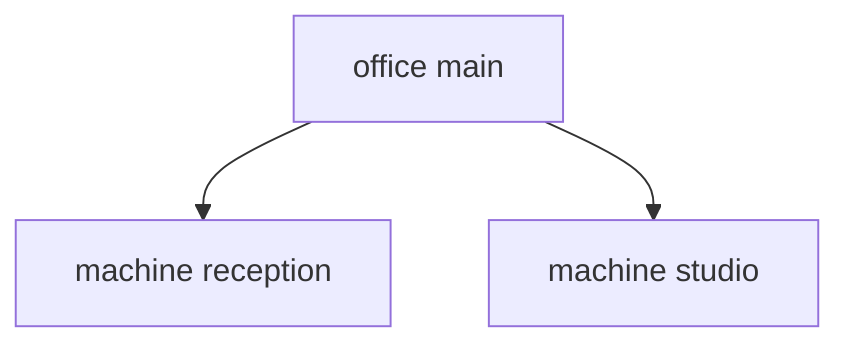
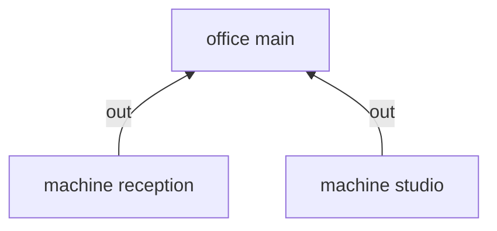

import { Aside, Badge, Card, CardGrid, FileTree, LinkButton, LinkCard, Steps, TabItem, Tabs } from '@astrojs/starlight/components';

yen is a query language for Nix configurations. You declare data and behavior in plain Nix files.
yen answers queries on them: the systems to build, the errors, and the graph of who gives what to whom.

yen is one small Nix file. It uses Nix builtins only: no nixpkgs, no module system, no flakes.
It never calls `throw`. An error is data that you can query.


<CardGrid>
<Card title="Kinds" icon="seti:json">

Typed data. A `host`, a `user`, an `environment`: you declare what exists and which fields it has.

</Card>
<Card title="Scopes" icon="list-format">

Where things live. `spawns` places each instance in a tree: a user under a host, a host under an environment.

</Card>
<Card title="Aspects" icon="puzzle">

Behavior. An aspect is active where its `at` predicate holds, and gives elements by key.

</Card>
<Card title="Sinks" icon="random">

Where elements go. An element goes up to the nearest scope that collects it, and the sink reduces them.

</Card>
</CardGrid>

## The four words

Everything in yen is one of four words. Read them once, in order, before any code:

1. **Kind.** A type of thing you configure, and the fields each one has. You name your kinds: `host`, `user`,
   `cluster`, `printer`, `editor`. An **instance** is one thing of a kind: `yen.host.web`.
2. **Scope.** One instance at one place in a tree. A kind's `spawns` says which instances live under it: a user
   under each host it logs in to, a host under its environment. The kind that nothing spawns is the root.
3. **Aspect.** One feature: "ssh on", "nginx with these sites". Its `at` is a predicate that says at which scopes
   it is active. Its other keys each give one **element**: a value, or a function of the data.
4. **Sink.** Where elements go. A kind declares sinks. An element goes up the tree to the nearest scope with a sink
   of the same name, and the sink reduces all its elements to one value: a list, a set, a merged attrset, one value.

So: kinds say what exists, scopes say where it lives, aspects say what to do, and sinks say who collects the result.
Sinks also build the outputs: the sink of a host can call `nixosSystem` on the modules it collected.


:::note[No batteries, no vocabulary]
yen knows no nouns. It has no `host`, no `user`, no `nixos` class, no NixOS or flake-parts options, and no
batteries such as Den's `define-user`. It is agnostic: you define the kinds, fields and sinks of what you configure,
in your own language. A fleet of NixOS hosts, a set of dev shells and a printer inventory use the same four words.
Every example in these docs declares its own kinds, so you can read each one top to bottom.
:::

## The four words in one example

This example has no NixOS. An office has two machines. Each machine collects a set of package names.

**Kinds and scopes.** `office` is the root kind, because nothing spawns it. It spawns every machine.
A machine has an `owner` field and a `packages` sink.


```nix title="modules/kinds.nix"
# Kinds: typed data. `office` is the root: nothing spawns it.
{ yen, lib, ... }:
{
  yen.kinds.office = {
    spawns.machine = _: yen.machine; # scopes: every machine lives in the office
    sinks.out.reduce = yen.lib.reduce.merge;
  };
  yen.kinds.machine = {
    fields.owner = lib.types.str;
    sinks.packages.reduce = yen.lib.reduce.set; # sinks: where elements go
    sinks.packages.out =
      { machine, packages, ... }:
      {
        inventory.${machine.name} = packages;
      };
  };

  yen.office.main = { };
  yen.machine.reception.owner = "ana";
  yen.machine.studio.owner = "bo";
  yen.flake = { out, ... }: out;
}
```

**Aspects.** `basics` is active at every machine. `design` is active at `studio` only.
`versioned-assets` is active wherever `design` is active: an aspect can be a predicate.


```nix title="modules/aspects.nix"
# Aspects: behavior, active where `at` holds. Each key gives one element to the sink of that name.
{ yen, ... }:
{
  yen.aspects.basics = {
    at = yen.kinds.machine; # every machine
    packages = "git";
  };
  yen.aspects.design = {
    at = yen.machine.studio; # one machine
    packages = "gimp";
  };
  yen.aspects.versioned-assets = {
    at = yen.aspects.design; # wherever `design` is active
    packages = "git"; # `set` keeps one copy
  };
}
```

**Sinks.** Each aspect key gives one element to the sink of that name. The `packages` sink of each machine
reduces its elements with `set`, so `git` arrives twice at `studio` and stays once:


```nix title="result"
{
  "office:main/machine:reception" = [
    "git"
  ];
  "office:main/machine:studio" = [
    "git"
    "gimp"
  ];
}
```

The scope tree and the routed elements, drawn from `r.graph`:


<Tabs>
<TabItem label="Scopes">



</TabItem>
<TabItem label="Routed elements">



</TabItem>
</Tabs>

## Data is queried, not merged

There is no `evalModules` fixpoint and no merge step. Each read of a declaration is a query on the files
that answer it. A value is computed only when something reads it. yen follows
[Cycle.js](https://cycle.js.org): a component reads sources and writes sinks, and Nix laziness closes the loop.


:::note[Why another configuration language?]
yen covers every capability of [Den](https://github.com/denful/den), den-hoag and [clan](https://clan.lol)
with these four words. On top, it answers questions: graph queries, Datalog with a well-founded semantics,
and µKanren with constraints, all in pure Nix. An agent can stage a change and get it refused with the reason,
before you deploy.
:::

<CardGrid>
<LinkCard title="Getting started" href="/start/getting-started/" description="One NixOS host, in four files." />
<LinkCard title="The reference fleet" href="https://github.com/vic/yen/tree/main/templates/fleet" description="Every capability, in one running specification." />
</CardGrid>

:::tip[Run this example]
Every block on this page is a file of the template `overview`. Copy it and run it:

```sh frame="terminal"
nix flake init -t github:vic/yen#overview
```

<FileTree>

- flake.nix
- modules/
  - aspects.nix
  - kinds.nix

</FileTree>
:::
