# yen fleet

<!-- Generated by github:sini/files from modules/docs. Edit there, then run `nix run .#write-files`. -->

## What yen is

yen is a query language for Nix configurations. You declare data and behavior in plain Nix files. yen answers queries on them: the NixOS systems, the homes, the flake outputs, the errors, the graph.

yen is a small Nix file with no dependencies. It uses builtins only. It does not use nixpkgs, the module system or flakes. It never calls `throw`: an error is data that you query.

yen follows [Cycle.js](https://cycle.js.org): a component reads sources and writes sinks, and drivers answer the sinks. In Nix, laziness closes the loop. There is no `evalModules` fixpoint and no merge step. A value is computed only when something reads it.

This fleet is the reference example. It models the [Ren](https://github.com/vic/ren) fleet template, every capability of [Den](https://github.com/denful/den) and of den-hoag (Den on Gen), and the advanced cases of four real configurations (sini, swarsel, adda, vix). Every section below points to the file that shows it.

## Start

```nix
# flake.nix
{
  inputs.yen.url = "github:vic/yen";
  inputs.import-tree.url = "github:denful/import-tree";
  inputs.nixpkgs.url = "github:nixos/nixpkgs/nixos-25.05";
  outputs = inputs: inputs.yen.lib.mkFlake {
    imports = [ (inputs.import-tree ./modules) ];
    _module.args = { inherit inputs; inherit (inputs.nixpkgs) lib; };
  };
}
```

yen reads one module. A module is a path, a function or an attrset, with three keys: `imports`, `_module.args` and `yen`. yen does not know what `inputs` or `lib` are. You give them as args, and they flow down the `imports` tree to every file below.

A file in `modules/` looks like this:

```nix
{ yen, lib, ... }:
{
  yen.kinds.host.fields.addr = lib.types.str;
  yen.host.lb.addr = "10.0.1.1";
  yen.aspects.motd = {
    at = yen.kinds.host;
    nixos.environment.etc.motd.text = "managed by yen";
  };
}
```

Without flakes, call `(import ./yen).lib.eval module`. The result is a set of queries (see [Queries](#queries)).

## Kinds and instances

A kind is a type of thing: `host`, `user`, `environment`. Its `fields` are the data of each instance.

```nix
yen.kinds.host.fields = {
  addr = lib.types.str;                      # any value with `check` is a type
  environment = yen.kinds.environment;      # a kind is a type too: a ref to an instance
  buildHost = yen.lib.maybe lib.types.str;  # null by default
  settings.kernel.channel = yen.lib.maybe (yen.helpers.enum [ "lts" "latest" ]);
};
yen.host.lb = { addr = "10.0.1.1"; environment = yen.environment.prod; };
```

A type is anything with `check = value: bool`. `lib.types`, your own `yen.lib.is builtins.isString`, and kinds all work. yen has no type system of its own. `yen.lib.opt type default` and `yen.lib.maybe type` add a default. `yen.lib.derive type (self: …)` computes the default from the instance itself:

```nix
yen.kinds.host.fields.vpn = yen.lib.derive lib.types.str (self: "vpn-${self.name}");
```

Fields are strict. A missing field, an unknown field, a failed check, or a string where a ref goes is an error record. The read gives `null`, and evaluation continues.

## Data is queried, not merged

Two files can declare types at two paths of one field. yen does not merge them. A read of a path is one query on the files that answer that path.

```nix
# features/zfs.nix
yen.kinds.machine.fields.settings.zfs.arcMax = yen.lib.maybe lib.types.int;
# features/k3s.nix
yen.kinds.machine.fields.settings.k3s.role = yen.lib.opt lib.types.str "agent";
```

A read of `host.settings.k3s.role` looks at the instance first, then at the type defaults, then checks the value. It never touches `zfs.nix`. Compare: a nixpkgs `submodule` runs one more `evalModules` for each value.

A cascade is a list in your order. `yen.lib.cascade path xs` gives the first non-null value along `xs` ([sini/settings.nix](modules/sini/settings.nix)):

```nix
setting = path: h: yen.lib.cascade path ([ h ] ++ h.environment.delegates ++ [ h.environment ]);
```

## Scopes: where things live

A scope is one instance at one place in a tree. The root kind has `spawns` and no kind spawns it. `spawns.<kind>` gives the children of a scope:

```nix
yen.kinds.environment.spawns.host = s: lib.filterAttrs (_: h: yen.lib.same h.environment s) yen.host;
```

The identity of a scope is its path: `fleet:main/environment:prod/host:lb`. One name can live in two places. In this fleet, `host:lb-minimal` lives under `host:lb` ([swarsel/variants.nix](modules/swarsel/variants.nix)). Names need not be unique.

A kind that no kind spawns is data: `group`, `channel`, `secret`. Its instances have no scope, and refs to them still work.

Siblings sort by the `order` sink (default `0`), then by key. A parent comes before its children.

## Aspects: behavior at scopes

An aspect is active at every scope where its `at` predicate holds. It gives elements to sinks by key.

```nix
yen.aspects.nginx = {
  at = [ yen.host.web-1 yen.host.web-2 yen.aspects.status ];  # a list is "any"
  nixos.services.nginx.enable = true;   # one element to the `nixos` sink
  backends = { host, ... }: host.addr;  # one element to the `backends` sink
  persist = "/var/lib/nginx";
};
```

A predicate is a function `scope: bool`. A kind ref, an instance ref, an aspect ref and a list are predicates too. Combine them with `yen.lib.all`, `not`, `within` (a proper ancestor holds) and `has` (a child holds).

`at` from several files is a union. To replace an aspect at one scope, put `not` in its `at` and write your own aspect ([features/motd.nix](modules/features/motd.nix)). A value in `at` that is not a predicate (a string, a number) is an error record, not a silent `false`.

One aspect can live in several files. Data under one key merges. Functions under one key each apply: two files that write `nixos = { … }: …` for the same aspect give two elements.

An aspect is active only at the scope where `at` holds. It never flows down to children: a host profile does not reach the host's guests.

Static content counts once per receiver. An aspect active at a host and at its users, with the same static `nixos` value, lands once on the host. Content that names the scope (`{ user, ... }:`) lands once per scope.

This rule decides how you write a value for a fleet-wide sink. A static value from many machines arrives once: use it for data that all machines share (a shared vars generator). A function value arrives once per machine: use it for data that each machine owns (a per-machine generator, `{ scope, ... }: …`). See [kits/vars.nix](modules/kits/vars.nix).

Structure can depend on presence: a `spawns` function can ask `yen.lib.holds yen.aspects.role-server s` at the parent ([den/presence-structure.nix](modules/den/presence-structure.nix)).

Each scope computes each aspect ref once, so aspects that read aspects cost linear time, however deep they nest. Refs can form cycles. A cycle through `not` has no answer: the aspects on it are undefined, as in the well-founded semantics of logic programs. They are not active, and the `undefined` query lists them. A cycle with no `not` (`p` where `q`, `q` where `p`) has no founded support, so it is false.

## Sinks: where elements go

A sink on a kind collects elements and reduces them:

```nix
yen.kinds.host.sinks.persist = { reduce = yen.lib.reduce.set; of = lib.types.str; };
```

| Reduce | Value | Error |
|---|---|---|
| `list` (default) | the elements in scope order | none |
| `set` | the elements without duplicates | none |
| `one` | the single element | 0 or 2+ elements |
| `merge` | a deep attrset | two different leaves at one path |
| `entries` | `[ { from; value; } ]`: the giving scope comes with each value | none |

An element goes to the nearest ancestor-or-self scope that has the sink and where the sink's `at` holds. A user under host `lb` gives `os`. The user has no `os` sink, the host has one, so the element goes to `lb`. The same user under a mac goes to the mac.

A sink's other keys give elements to other sinks. They run at the receiver, with the receiver's args:

```nix
yen.kinds.host.sinks.os.nixos = { os, ... }: { imports = os; };        # os feeds nixos: one `os` for NixOS and darwin
yen.kinds.guest.sinks.nixos.nixos = { guest, nixos, ... }: {           # its own name: a forward, strictly up
  microvm.vms.${guest.name}.config.imports = nixos;
};
```

A sink that nobody reads is not an error. Nothing happens. A sink with no keys is a wall: `yen.kinds.home.sinks.os = { }` keeps a home's elements away from the host above it.

A sink's `reduce` can be any function `[ { from; value; } ] -> { value; errors; }`. Write your own when the merge order is the point: per-key strategies with provenance ([hoag/ci.nix](modules/hoag/ci.nix)), ranked layers ([hoag/settings.nix](modules/hoag/settings.nix)), dedup of claims, an export store where a member can only write its own scope ([kits/assemblies.nix](modules/kits/assemblies.nix)). The engine sets `from`. An element cannot say where it comes from, so a scope cannot write for another.

Give errors and warnings as data. An aspect key `errors` adds records to the `errors` query. A sink such as `warnings` (with `reduce.list`) holds messages that do not fail the fleet.

Do not give a sink the name of a field or an arg. A sink `tags` and a field `tags` read as one arg. In this fleet, clan tags are the field `labels` for that reason.

The `out` sink of the root is the flake. `yen.flake = { out, ... }: out;` gives it.

## Args: reading data

An element can be a function with named args. yen fills the args it knows:

| Arg | Value |
|---|---|
| a kind name (`host`, `environment`) | the nearest ancestor-or-self scope of that kind |
| a sink name (`backends`, `persist`) | the reduced value of that sink at its nearest receiver |
| `scope` | the scope itself |

Other args (`pkgs`, `lib`, `config`) stay open. The element is then a module function for NixOS or home-manager, with yen's args already filled.

If an arg has no answer, the element is not given, and `errors` lists it. `{ cluster ? null, ... }` makes the arg optional. A bare `final: prev:` is an error: wrap it as `{ ... }: final: prev: …`.

## The cycle form

The keys above give one element each. For 0 to n elements, or to ask the tree for data, write a component:

```nix
yen.aspects.kernel = {
  at = yen.kinds.host;
  cycle = { tree, ... }: {
    tree = [ { category = "env"; nearest = yen.kinds.environment; } ];   # a request
    nixos = map (env: { boot.kernelParams = [ "env=${env.name}" ]; }) (tree.select "env");
    errors = [ ];                                                          # a component can report errors
  };
};
```

Tree requests: `nearest = <kind>`, `parent = true`, `children = <predicate>`, `scopesOf = <instance>`, `holds = <predicate>`.

## Queries

`yen.lib.eval module` gives queries, not one value:

| Query | Answer |
|---|---|
| `errors` | `[ { error; from; } ]`, empty when the fleet is valid |
| `graph` | `{ scopes; edges; }`: every scope and every routed element |
| `scopes` | the scopes in order |
| `active` | aspect, then scope id, then `true` or `false` |
| `undefined` | `[ { aspect; scope; } ]`: aspects that `at` cannot decide, because of a cycle through `not` (`a` where not `b`, `b` where not `a`). They are not active. |
| `reduced` | sink, then receiver id, then the value |
| `flake` | the answer of `yen.flake` |

`yen.lib.graph` is readable inside the fleet. Each edge has `sink`, `from`, `to` and `origin` (the aspect that gave the element), so "which aspects reach this host" is a query, not a registry. The diagrams and tables at the end of this README come from `graph`, the kind declarations and sink values ([docs/readme.nix](modules/docs/readme.nix)): the fleet map, the kind tree, sink forwarding, pools, clan instances, vars generators and the deploy order.

## Graphs, Datalog and krn

Fleet data is plain Nix, so a question about it is a function. yen ships three libraries for the hard ones. Each is builtins only, total, and gives the same answer whatever the file order.

**`yen.lib.graphs`** works on `succ`, an attrset from a node to its successors: `reach`, `reachers`, `transpose`, `topo` (a cycle is data: `{ ok = false; stuck; }`), `layers`, `sccs`, `cycles`, `shortest`, `paths`. [hoag/relations.nix](modules/hoag/relations.nix) builds the deploy waves, the dependents and the impact of losing a host, and gives an error for a dependency cycle:

```nix
dependsOn = lib.mapAttrs (_: h: map (d: d.name) h.dependsOn) hosts;
deployWaves = G.layers dependsOn;                                 # [ [ "lb" ] [ "web-1" "web-2" ] [ "stage" ] ]
impact = lib.genAttrs (lib.attrNames hosts) (G.reachers dependsOn); # lb down: stage, web-1, web-2 break
```

**`yen.lib.datalog`** solves ground rules with negation, `{ head; pos; neg; }`. You ground the rules with Nix (one per host). `wfs` gives the well-founded model (true, false, undefined; no strata). `stable` gives the stable models: a choice. `why` gives the rules that prove an atom. [query/datalog.nix](modules/query/datalog.nix) is a serving policy: a host serves when it runs nginx and is not drained. A host is drained when it is in maintenance or the host it depends on is down. The database primary is a choice between two hosts. An atom the policy leaves undefined is an error.

```nix
{ head = "serves:${n}"; pos = [ "web:${n}" ]; neg = [ "drained:${n}" ]; }
{ head = "drained:${n}"; neg = [ "up:${d.name}" ]; }              # for each host n depends on
{ head = "primary:lb"; neg = [ "primary:web-1" ]; }                # and the other way round: two stable models
```

**`yen.lib.krn`** is µKanren with constraints: logic variables, unification over attrsets, lists and scalars (with an occurs check), and goals that run in both directions. It synthesizes values that meet constraints.

| Goal | Meaning |
|---|---|
| `eq u v`, `fresh ({ a, b }: …)`, `freshNamed names (vs: …)`, `disj`, `conde`, `project` | µKanren: unify, new variables, any of, clauses, read a value |
| `neq u v` | `u` and `v` never unify. The store keeps the constraint, so its place in the goal list does not matter. |
| `dom x [ … ]`, `infd xs lo hi` | finite domains |
| `lefd`, `ltfd`, `plusfd x y z`, `neqfd`, `distinctfd xs` | propagation over domains, to a fixpoint after every change |
| `label xs` | enumerate the values left, smallest domain first |
| `nil`, `cons h t`, `appendo`, `membero`, `fromList`, `toList` | relational lists as cons cells, as in Scheme: a list of unknown length grows, and `appendo` runs in every direction |
| `facto rows pattern` | a table of facts |
| `run n`, `runAll`, `runC n` | answers; `runC` adds the constraints left on fresh variables (`{ value; neq; dom; }`) |

[query/krn.nix](modules/query/krn.nix) uses them on fleet data. Each app on lb gets a port in its range: all different, and prometheus before grafana. The same relation, run backward, answers which apps can take port 8081. Each guest on stage gets memory in its range, and the guests' sum plus the host's reserve fits its RAM. A join over host records places each host's database:

```nix
portsRel = h: q: freshNamed h.apps (vs: [ (infd (lib.attrValues vs) 8080 8083) (distinctfd (lib.attrValues vs)) (ltfd vs.prometheus vs.grafana) (eq q vs) (label (lib.attrValues vs)) ]);
# [ { grafana = 8081; loki = 8082; prometheus = 8080; } ]
memRel: (plusfd 0 ci s0) (plusfd s0 build s1) (lefd s1 (ram - reserve))   # running sums of the guests
runAll (q: fresh ({ env, d, own }: [ (facto hosts { name = "web-1"; inherit env; db = own; }) (facto hosts { name = d; inherit env; db = true; }) (eq q d) ]))
```

A search with no answer gives `[ ]`. Give an error record then, as `port-synthesis` and `memory-synthesis` do. krn has no constraints over terms other than `neq` (no `absento`), and `appendo` with two unknown lists enumerates without end: use `run n`.

## For agents: ask, prove, change

An agent that manages this fleet works through queries. Every answer is data that `builtins.toJSON` can print. `query.nix` gives them on the command line, for example the `agent` attribute with `--json`.

| Query | Answer |
|---|---|
| `schema` | every kind (fields with type names and defaults, spawns, sinks with their reduce strategy), every aspect (keys, files, how many scopes) and every invariant |
| `agent` | `schema`, `errors`, `check` and counts, JSON-safe |
| `context id { maxEdges; maxAspects; }` | one scope: parent, children, active aspects, the elements it gives and receives, its errors. Each list says `truncated = { shown; of; }` |
| `explain aspect id depth` | why an aspect is active, inactive or undefined at a scope: a trace of its `at` (true, false or null at each node), what it gives, its files. Past the depth, `kids = "cut"` |
| `declaredIn path` | the files that answer a declaration path, in file order |
| `facts` | the fleet as typed atoms: `[ "kind" K ID ]`, `[ "instance" ID KIND NAME ]`, `[ "has" ASPECT ID ]`, `[ "edge" SINK FROM TO ]`, `[ "error" CODE FROM ]` |
| `check` | the invariants: `violations`, `incomplete`, `ok`, `why atom` |

An unknown aspect or scope gives an error record with `near`: the names it was probably meant to be.

**Error records.** Each error has `error` and `from` for people, and `code`, `path`, `got`, `want`, `fix`, `class` and `near` for agents. `class` is `fixable` (an edit to the data fixes it) or `authority` (no edit by this author can).

```nix
{ code = "check"; path = [ "port" ]; got = 70000; want = "Port"; fix = "give port a value of type Port"; class = "fixable"; from = "host:a"; }
{ code = "unknown-field"; path = [ "prot" ]; near = [ "port" ]; … }
```

**Invariants.** `yen.invariants.<name>` gives Datalog rules over the facts ([agent/invariants.nix](modules/agent/invariants.nix)). A rule is a function of its variables, and its literals are references from `yen.facts` and `yen.relations`, never strings: a typo is an evaluation error. A rule with `bad = M` that holds is the violation `[ "bad" <invariant> M ]`. An undefined one (a cycle through `not`) is `incomplete`, never a pass.

```nix
yen.invariants.attic = { M }: { bad = M; pos = [ (yen.facts.kind yen.kinds.mac M) (yen.facts.has yen.aspects.attic M) ]; };
```

**Changes go through `stage`.** `yen.lib.stage { base; change; rejected ? [ ]; grant ? null; }` evaluates the fleet without and with the change. Nothing is applied. It returns the new errors, the new violations, a diff (scopes, routed elements, active aspects), the change's `sha` and the `refused` list. `ok` is true only when nothing new is wrong. A change in `rejected`, and a change that can reach a scope outside the grant, are refused with `class = "authority"`. `render` is the change as JSON, so it can be read back and staged again.

```nix
yen.lib.stage { base = fleet; change = { yen.aspects.attic.at = [ { kind = "mac"; name = "studio"; } ]; }; }
# ok = false; violations = [ [ "bad" "attic-on-mac" "…/mac:studio" ] ]; diff.active.added = [ "attic@…/mac:studio" ]
```

**Proofs and why-not.** `yen.lib.datalog` adds `proof rules model atom` (a proof tree; a positive cycle shows `cycle = true`), `whyNot rules model atom` (per rule: the `missing` positive atoms, the `blocking` negative ones, the undefined ones) and `judge rules a notA` (`supported`, `refuted`, `both`, `neither` or `unknown`). [query/datalog.nix](modules/query/datalog.nix) gives `out.serving.whyNot.<host>` and judges the database primary: `unknown`, a choice the policy leaves open.

**Knowledge packs.** `yen.lib.rdf.share result` gives the eval result as sorted N-Triples with a sha256 and a count: scopes, kinds, parents, active aspects, every routed element as a node with its origin, and errors. The same fleet gives the same hash in every file order, so two revisions compare by hash first. [agent/rdf.nix](modules/agent/rdf.nix) packs the routing graph as `out.rdfPack`.

**Stored queries.** `yen.queries.<name> = { host, result }: …` names a question. `result` is the eval result; the other formal args are its parameters, required unless they have a default. `result.queries` lists them with `required` and `optional`, and `result.ask name args` answers, or gives an error record for an unknown query, a missing parameter or an unknown one ([agent/queries.nix](modules/agent/queries.nix)).

**What else breaks, and what if it were gone.** `result.impact id { hops; sinks; max; }` follows routed elements from a scope, by depth, with `truncated`. `yen.lib.without { files; path; args; }` evaluates the fleet without the files that declare `path`: a whole file goes, there is no hook to remove part of one.

**History and valid time.** `yen.lib.asOf { url; rev; module; }` evaluates the fleet at a git revision; `yen.lib.history { url; revs; module; }` lists each revision with the field changes from the one before (`diffData` over `result.data`). Valid time is data: an instance with `validFrom` or `validTo` holds at a date the caller passes, `yen.lib.validAt "2026-11-15"`. Pure evaluation has no clock.

**Labels.** `yen.labels."agent/" = { trust = 1; }` labels the content of files whose path contains `agent/`. An aspect declared in several files takes the lowest trust of them (the meet). `result.labels` gives each aspect's label and `result.floor 3` every routed element of an aspect below trust 3, with the file.

**A knowledge pack per revision.** An agent that keeps a store such as quipu knots `yen.lib.rdf.share result` into a named graph under one snapshot key, with `replace_snapshot`. Each revision replaces the last; the old one stays readable by transaction:

```
SELECT ?name WHERE { ?s rdf:type <https://yen.dev/fleet/kind/host> ; <https://yen.dev/fleet/yen/name> ?name }
# at the first revision's tx: db, web.   Now: web.
```

**Bounded search.** A krn query an agent writes must stop. `yen.lib.krn.runFuel n fuel f` and `runAllFuel fuel f` count each search step and return `{ answers; complete; }`: `complete = false` means "bounded", never "no answer". `maximize fuel measure f` gives `{ best; value; complete; count; }`; a best found under `complete = false` is not proven optimal. [query/krn.nix](modules/query/krn.nix) gives guest memory by `maximize` with `ramFuel` steps; a search that runs out of fuel is an error record.

**Shapes.** `yen.lib.rdf.shacl result` gives SHACL shapes from the schema: one node shape per kind with scopes, `yen:name` required, `yen:parent` of the spawning kind, each field at most once, and `sh:class` for ref fields. The pack types every instance, so a ref meets its class. quipu's validator accepts the pack of a fixture fleet and reports one `sh:class` violation for a ref to a missing instance.

**An MCP server.** `mcp/` at the top of the yen repository, a small Rust binary, answers agents over stdio (JSON-RPC, MCP). Its 14 tools: `yen_schema`, `yen_check`, `yen_context`, `yen_explain`, `yen_errors`, `yen_declared_in`, `yen_export` (the knowledge pack; the agent decides whether to store it), `yen_stage` (a change as JSON, in quarantine), `yen_queries` and `yen_ask` (stored queries, the synthesis ones included), `yen_impact`, `yen_labels` (with `floor`), `yen_why_not` (an atom's why and why-not) and `yen_program` (a change program, validated and dry-run). Each answer is `{ complete; result }` or `{ complete = false; error }`; a timeout is never an empty answer. Arguments reach Nix through a file and `builtins.fromJSON`, never through string interpolation. `mcp/test.sh` drives it. `nix run .#yen-mcp` from the fleet directory runs it as a flake app ([agent/mcp.nix](modules/agent/mcp.nix)): it serves the fleet in the working directory, and its flake ref comes from the git top (`YEN_FLAKE` overrides it).

**Safe between machines, before deploy.** Field literals such as `yen.facts.machine.dbOn H D` read field values and refs. Invariants over them hold across machines ([agent/invariants.nix](modules/agent/invariants.nix)): a host's database is in its own environment (`db-exists`, `db-same-env`), no two machines share an address (`unique-addr`), and a host never depends on a host in a less trusted environment (`trust-order`). A staged change that breaks one is refused with the atom, and `check.whyNot` / `check.proof` explain an answer.

**Change programs.** `yen.lib.program` writes a change as data ops: `set`, `ref`, `place` and `new`. `validate result prog` checks it against the schema (with `near`), `toModule` makes the module, `dryRun { base; prog; }` validates and stages it, and `render` gives JSON. An agent writes a program, not Nix code.

**Install order.** The stored query `installOrder { assembly }` gives the waves of an assembly: the servers first, then the clients ([agent/queries.nix](modules/agent/queries.nix), `yen.lib.graphs.layers`). For the backup instance: `[ [ "lb" ] [ … every client … ] ]`.

**Synthesis, checked.** Stored queries in [agent/synthesis.nix](modules/agent/synthesis.nix) answer with values that already meet the rules. `freePort { host }` lets krn pick a port no app on the host uses. `placeDb { host }` joins host records to find the database hosts of its environment. `safeHostsFor { aspect; env }` stages the aspect on each machine of the environment and returns where it is safe, and why the others are refused:

```nix
result.ask "safeHostsFor" { aspect = "attic"; env = "staging"; }
# { safe = [ "stage" ]; refused.studio = [ [ "bad" "attic-on-mac" "fleet:main/environment:staging/mac:studio" ] ]; }
```

**Grants only narrow.** `yen.lib.grant { scopes = [ id prefixes ]; sinks ? null; }` says where an agent may reach. `narrow g h` keeps what both allow. No function makes a grant wider. A module can read the whole fleet through `yen`, so a staged change that declares anything is refused at every scope outside its grant.

## Patterns in this fleet

| Pattern | From | File |
|---|---|---|
| hosts from JSON, refs from names | Ren | [hosts/inventory.nix](modules/hosts/inventory.nix) |
| users on machines from nested group grants | Ren, Den | [helpers.nix](modules/helpers.nix), [topology/access.nix](modules/topology/access.nix) |
| one `os` sink for NixOS and darwin | Ren #76 | [platforms/nixos.nix](modules/platforms/nixos.nix), [platforms/darwin.nix](modules/platforms/darwin.nix) |
| microvm guest forwards into its host | Ren, Den | [platforms/microvm.nix](modules/platforms/microvm.nix) |
| a diamond lands once per scope | Den #468 | [features/web.nix](modules/features/web.nix) |
| substitute with `not` | Den | [features/motd.nix](modules/features/motd.nix) |
| a check that reads a built system | Ren #60 | [topology/systems.nix](modules/topology/systems.nix) |
| specialisations as a variant kind | Den | [platforms/variants.nix](modules/platforms/variants.nix) |
| deterministic ids from sorted names | Den | [den/ids.nix](modules/den/ids.nix) |
| a standalone home that reads its host's data | Den #739 | [den/standalone-home-on-host.nix](modules/den/standalone-home-on-host.nix) |
| fan-out: every user × every pet (cartesian), toys of each pet (transitive), landing at the host | Den | [den/patterns.nix](modules/den/patterns.nix) |
| context enrichment: a sink is context (`isNixos`, then `platform`) | Den | [den/patterns.nix](modules/den/patterns.nix) |
| host-written home content for users who opt in, run in the user's context | Den host-aspects | [den/patterns.nix](modules/den/patterns.nix) |
| broadcast: the sender tags who receives | Den pipes | [den/patterns.nix](modules/den/patterns.nix) |
| a pipeline stage between producers and consumers | Den pipes | [den/patterns.nix](modules/den/patterns.nix) |
| one class into both NixOS and home-manager, and per-user home classes (`classes = [ maid ]`) | Den | [den/patterns.nix](modules/den/patterns.nix), [den/custom-classes.nix](modules/den/custom-classes.nix) |
| a value that reads its producer's realized config | Den #713 | [den/patterns.nix](modules/den/patterns.nix) |
| structure from presence: a child scope only where an aspect holds | Den #525 | [den/presence-structure.nix](modules/den/presence-structure.nix) |
| discovery: k3s nodes per cluster, ingest across environments | sini | [sini/clusters.nix](modules/sini/clusters.nix) |
| recursive kinds: domains under domains | sini | [sini/domains.nix](modules/sini/domains.nix) |
| conditional receivers: terranix, unifi | sini | [sini/network.nix](modules/sini/network.nix) |
| a mesh: each host reads its peers, drops itself | sini | [sini/mesh.nix](modules/sini/mesh.nix) |
| settings cascade with delegation | sini | [sini/settings.nix](modules/sini/settings.nix) |
| tags from active role aspects | sini | [sini/roles.nix](modules/sini/roles.nix) |
| one sink name on three kinds | sini | [sini/secrets.nix](modules/sini/secrets.nix) |
| a trust filter on the reader side | sini | [sini/xmsg.nix](modules/sini/xmsg.nix) |
| devshell, formatter, hooks: sink to sink | sini | [sini/flake.nix](modules/sini/flake.nix) |
| access by labelled groups: machine grants and gates, SSO-only users | sini | [topology/access.nix](modules/topology/access.nix), [sini/services.nix](modules/sini/services.nix) |
| an allow-list joined from three fleet pools, with an error for a client that has no address | sini | [sini/services.nix](modules/sini/services.nix) |
| first node starts the cluster, the others join | sini | [sini/clusters.nix](modules/sini/clusters.nix) |
| two pools joined by host, in the cluster's environment; a guest's intent read by its parent | sini | [sini/joins.nix](modules/sini/joins.nix) |
| aspect factories; an aspect checked alone with stand-in args; one DNS edge at most | sini | [sini/joins.nix](modules/sini/joins.nix) |
| merge strategy per key with provenance and refs; claim dedup; negation; demand cascade; shadowing query; suppression chain | den-hoag CI | [hoag/ci.nix](modules/hoag/ci.nix) |
| assemblies of kits × roles, once per assembly and once per machine, layered typed settings, contract errors | clan | [kits/assemblies.nix](modules/kits/assemblies.nix), [kits/kits.nix](modules/kits/kits.nix) |
| exports: scoped by the engine, allow-listed per kit, read across kits, overridden by the owner | clan | [kits/assemblies.nix](modules/kits/assemblies.nix), [services/borg.nix](services/borg.nix) |
| vars: generator graph, shared or per machine, a deploy plan as data, secret-read guard | clan | [kits/vars.nix](modules/kits/vars.nix) |
| machines from directories, a kit from outside `modules/` | clan | [kits/vars.nix](modules/kits/vars.nix), [services/borg.nix](services/borg.nix) |
| deploy waves, impact of losing a host, a dependency cycle as an error (`yen.lib.graphs`) | den-hoag | [hoag/relations.nix](modules/hoag/relations.nix) |
| a serving policy with maintenance, drain by dependency, a primary chosen by stable models (`yen.lib.datalog`) | Gen | [query/datalog.nix](modules/query/datalog.nix) |
| port allocation, guest memory, database placement, a query run backward (`yen.lib.krn` with finite domains) | µKanren, CLP(FD) | [query/krn.nix](modules/query/krn.nix) |
| one machine, two builds | swarsel | [swarsel/variants.nix](modules/swarsel/variants.nix) |
| one machine writes config into another, and fleet globals | swarsel | [swarsel/distributed.nix](modules/swarsel/distributed.nix) |
| aspects exported as `nixosModules` | swarsel, Den | [swarsel/exports.nix](modules/swarsel/exports.nix) |
| service domains into a reverse proxy, and flake templates | adda | [adda/services.nix](modules/adda/services.nix) |
| a child kind declared in another file, and feature gates | vix | [vix/editors.nix](modules/vix/editors.nix) |
| secrets as a data kind | vix | [vix/secrets.nix](modules/vix/secrets.nix) |

### `osConfig`: a home-manager module that reads its host

Each host gives its realized NixOS config to an `osConfig` sink. A home-manager module names `osConfig` like any sink arg. `pkgs` stays open, so home-manager fills its own `pkgs`:

```nix
yen.kinds.host.sinks.osConfig.reduce = yen.lib.reduce.one;
yen.aspects.os-config = {
  at = yen.kinds.host;
  osConfig = { host, out, ... }: out.nixosConfigurations.${host.name}.config; # lazy
};
yen.aspects.editors = {
  at = yen.lib.all [ yen.kinds.user (yen.lib.within yen.kinds.host) ];
  homeManager = { osConfig, pkgs, ... }: {
    home.sessionVariables.EDITOR_HOST = osConfig.networking.hostName;
    home.packages = [ pkgs.nano ];
  };
};
```

The same aspect works for a user in a host's NixOS (`alice` on `lb`) and for a standalone home under a host (`alice@stage`). The e2e checks `os-config-nested` and `os-config-standalone` prove it ([den/os-config.nix](modules/den/os-config.nix)).

### Den #739: a standalone home that reads host data

In [den#739](https://github.com/denful/den/discussions/739), a Den user wants host data (a monitor) in a standalone home `tux@igloo`. Den pipes the data to a home-manager module home only.

In yen, where a scope lives (`spawns`) and what it builds (`out`) are separate. The home `alice@stage` lives under host `stage`:

```nix
yen.kinds.host.spawns.home = s: lib.filterAttrs (_: h: yen.lib.same h.on s) yen.home;
yen.home."alice@stage" = { user = yen.user.alice; on = yen.host.stage; /* … */ };
yen.aspects.monitor-env.homeManager = { monitor ? null, ... }: { home.sessionVariables.MONITORRES = monitor.resolution; };
```

The home reads stage's `monitor` sink like any child. It still builds its own `homeConfigurations."alice@stage"`. Its `os` sink is a wall, so its users do not change stage's NixOS.

## yen, Den and Den on Gen

[Den](https://github.com/denful/den) has 1,365 CI tests in 289 files. Every one was read for the usage pattern it pins ([vic/den-patterns.md](https://github.com/vic/yen/blob/main/vic/den-patterns.md): 168 patterns). [den-hoag](https://github.com/sini/den-hoag), Den's next version on the [Gen](https://github.com/sini/gen) libraries, has 18 laws. This fleet shows each of their capabilities with yen's four words. Every row has a check in `tests.nix`.

| Den / den-hoag | yen | File |
|---|---|---|
| `den.default`, schema includes, batteries | an aspect with `at = yen.kinds.<kind>` | [den/batteries.nix](modules/den/batteries.nix) |
| includes, excludes, substitute, instance-side includes | `at` with aspect refs, `not`, `at` from any file | [features/motd.nix](modules/features/motd.nix), [sini/roles.nix](modules/sini/roles.nix) |
| custom classes, chained forwards (hjem, maid) | a user sink whose keys feed other sinks | [den/custom-classes.nix](modules/den/custom-classes.nix) |
| `hasAspect`, projected `hasAspect` | `yen.lib.holds`, and `graph` edges with `origin` | [sini/roles.nix](modules/sini/roles.nix) |
| a policy gated on `hasAspect` that creates structure (#525) | `spawns` that reads `holds` at the parent | [den/presence-structure.nix](modules/den/presence-structure.nix) |
| quirks and pipes: collect, expose, broadcast, provenance | a sink at a common ancestor with `entries`, and a filter in the reader | [sini/clusters.nix](modules/sini/clusters.nix) |
| a value that reads a realized config (#713, `osConfig`) | an `osConfig` sink that each host gives from `out.nixosConfigurations.<host>.config`, lazily | [den/os-config.nix](modules/den/os-config.nix), [den/standalone-home-on-host.nix](modules/den/standalone-home-on-host.nix) |
| settings layers with authority, the projects facet (A8, A14) | a sink with your own reduce | [hoag/settings.nix](modules/hoag/settings.nix) |
| claim and provide, "who claims me" | an `entries` sink and a reader filter | [hoag/claims.nix](modules/hoag/claims.nix) |
| collectors: an aggregate with its own content | a `hive` kind that selects its members | [hoag/collectors.nix](modules/hoag/collectors.nix) |
| relations and the query calculus (`rel*`, layers) | plain Nix over ref fields, with `genericClosure` | [hoag/relations.nix](modules/hoag/relations.nix) |
| permutation-stable output (A12), per-member laziness (A17) | file order never changes a result, and sinks are lazy per receiver | `tests.nix`: `den-permutation-stable`, `den-sibling-laziness` |
| class-share (A18): the config every member of a class shares is built once, gated against the full build | the core is the elements equal at every host; each host's shared build has the same toplevel `drvPath` as its full build | [hoag/class-share.nix](modules/hoag/class-share.nix) |

The den-hoag CI (175 test files and 57 Den behavior tests) gives 119 capabilities ([vic/hoag-ci-patterns.txt](https://github.com/vic/yen/blob/main/vic/hoag-ci-patterns.txt)): 92 have a check here, 25 are den-hoag mechanisms with no effect for a fleet author (strata, codomain declarations, commitments), and 2 are open design questions. Each den-hoag "discipline" is a reduce function or a plain query in yen ([hoag/ci.nix](modules/hoag/ci.nix)).

sini's fleet ([sini/nix-config](https://github.com/sini/nix-config)) gives 98 patterns ([vic/sini-patterns.md](https://github.com/vic/yen/blob/main/vic/sini-patterns.md)). Every one has a check, except packaging.

yen needs no strata, no effect runtime and no registry of merge algebras. The Nix lazy `let` is the only fixpoint for data; `yen.lib.datalog` gives the well-founded model when your rules need one. Structure can depend on presence at a parent, and two hosts can point at each other with no cycle error.

Three families of Den bugs cannot happen in yen:

- **Double delivery.** An element has one id per receiver.
- **Lost content when one aspect is in two files.** A read queries all files. Nothing merges early.
- **A host's home-manager content leaking to its users.** Elements go up the tree, never down.

## yen and clan

[clan](https://clan.lol) adds service instances, roles, exports and vars on top of NixOS. yen models them with its own words: a kit is data, an assembly is one use of a kit, and every selection is a ref or a predicate, never a name or a tag. All its docs, its 31 services and its library give 79 capabilities ([vic/clan-patterns.txt](https://github.com/vic/yen/blob/main/vic/clan-patterns.txt)): 64 have a check here, 6 are clan internals, and 9 are tools (CLI, installers, secret generation). yen covers the configuration, not the tools.

| clan | yen | File |
|---|---|---|
| machines with tags (`all`, `nixos`, `darwin` are automatic) | predicates: a kind (`yen.kinds.host`), a ref (`yen.host.lb`), an aspect, a function of the machine | [kits/kits.nix](modules/kits/kits.nix) |
| `inventory.instances.<i>`, `module.name` | the data kind `assembly`; its field `kit` is a ref to a `kit` | [kits/assemblies.nix](modules/kits/assemblies.nix) |
| role members: named machines and tagged machines | `roles.<r>.at`, a predicate; each machine spawns one `member` scope per (assembly, role) | [kits/assemblies.nix](modules/kits/assemblies.nix) |
| `perInstance` | an aspect at a member scope | [kits/kits.nix](modules/kits/kits.nix) |
| `perMachine` | an aspect at a machine that `has` a member | [kits/kits.nix](modules/kits/kits.nix) |
| role settings, then machine settings, typed by the role interface | interface defaults, then the role's settings (attrs, or a function of the machine); a wrong type is an error record | [kits/assemblies.nix](modules/kits/assemblies.nix) |
| exports, `selectExports`, scope rules | a fleet sink; the engine sets the writer; a kit lists its keys; a reader filters by refs (`yen.lib.same`); the owner overrides from the fleet scope | [kits/assemblies.nix](modules/kits/assemblies.nix) |
| a service from another flake (`module.input`) | a module file that declares a kit, imported | [services/borg.nix](services/borg.nix) |
| vars generators, `share`, dependencies, `neededFor`, `deploy = false`, recipients | the `generators` sink and `out.varsPlan` | [kits/vars.nix](modules/kits/vars.nix) |
| autoincludes from `machines/<name>/` | a host per directory (field `fromDir`), its `configuration.nix` imported | [kits/vars.nix](modules/kits/vars.nix) |

## Shared pkgs: one nixpkgs per channel and system

yen's own part of a host is small: on lb it is 1.4% of the evaluation. Most of the time goes to nixpkgs `pkgs` (56%) and the NixOS module system (36%) ([vic/evalmodules-research.md](https://github.com/vic/yen/blob/main/vic/evalmodules-research.md)). By default each host imports nixpkgs again. A host with `sharedPkgs = true` reuses the `pkgs` of the first sharing host on its channel and system, through nixpkgs' `readOnlyPkgs` ([platforms/nixos.nix](modules/platforms/nixos.nix)).

The `lab` environment compares the two: `app-1`, `app-2` and `app-3` share, `app-4` builds its own ([hosts/apps.nix](modules/hosts/apps.nix)). `bench-shared.nix` evaluates app-1..3 both ways:

| app-1..3 toplevel | CPU | Thunks | Function calls |
|---|---|---|---|
| each its own pkgs | 19.0 s | 21.7 M | 17.0 M |
| shared pkgs | 12.7 s | 16.8 M | 12.9 M |

The prod hosts share too: `lb`, its variant `lb-minimal`, `web-1` and `web-2` join app-1's group (same channel and system). Evaluated both ways (`--arg hosts '[ "lb" "web-1" "web-2" ]'`):

| lb, web-1, web-2 toplevel | CPU | Thunks | Function calls | Values | Sets | Lists | GC total |
|---|---|---|---|---|---|---|---|
| each its own pkgs | 35.3 s | 36.6 M | 27.9 M | 806 MB | 929 MB | 76 MB | 2.71 GB |
| shared pkgs | 24.8 s | 29.3 M | 21.9 M | 641 MB | 585 MB | 61 MB | 1.96 GB |

The `drvPath`s are the same both ways. The e2e check `shared-pkgs-same-drv` proves it on every run, for all six followers: each follower's toplevel equals its build with its own `pkgs` (`nixosConfigurationsOwnPkgs`).

Two rules. A sharing host cannot set `nixpkgs.config` or `nixpkgs.overlays` of its own: its group shares them, so every host in the group must give the same. Here the overlays are fleet-wide, and the unfree and insecure permits are only on `stage`, which does not share. And documentation is off on every sharing host (`shared-pkgs-no-docs` in [platforms/nixos.nix](modules/platforms/nixos.nix)), because the manual and man pages differ when `pkgs` is shared. With docs on, the e2e check fails.

### A smaller NixOS module list

A host with `trimmedModules = true` evaluates only the NixOS base modules it needs: about 397 of 1,899 ([platforms/_modlists.nix](modules/platforms/_modlists.nix), computed in [vic/modlist-research.md](https://github.com/vic/yen/blob/main/vic/modlist-research.md) as the closure of a learned core and the options the host defines). The list filters `module-list.nix` itself, so the order and the inline entries stay. `web-1` and `app-2` use it:

| web-1, app-2 toplevel | CPU | Thunks | Function calls | Values | Sets | Lists | GC total |
|---|---|---|---|---|---|---|---|
| full list | 11.4 s | 14.57 M | 11.15 M | 323 MB | 327 MB | 31.1 MB | 1.03 GB |
| trimmed list | 10.5 s | 13.21 M | 10.15 M | 290 MB | 302 MB | 28.1 MB | 0.94 GB |

Three oracles hold it: the e2e check `modlist-same-drv` (each trimmed toplevel has the same `drvPath` as `nixosConfigurationsFull`), `modlist-negative` (the list without nginx fails for web-1, and the same list with nginx builds), and `bash cost.sh` (the drvPaths match and the trimmed eval uses at most 95% of the thunks). The lists belong to one nixpkgs revision: after an update, `modlist-same-drv` fails until they are computed again.

## Generated files and checks

`flake.nix`, `README.md` and `ci.json` are generated. Do not edit them. Edit `modules/`, then run:

```sh
nix run .#write-flake    # flake.nix from the `flake-file` sink (github:vic/flake-file)
nix run .#write-files    # README.md and ci.json (github:sini/files)
nix flake check          # fails if a generated file is stale
```

Each aspect declares the flake inputs it uses on the `flake-file` sink. The generated `flake.nix` has exactly those inputs.

`nix flake check` runs these checks on `x86_64-linux`:

| Check | What it proves |
|---|---|
| `flake-file` | `flake.nix` matches the inputs that the aspects declare |
| `files/README.md`, `files/ci.json` | the committed files match the fleet |
| `infra-<host>` | each fact that aspects state from fleet data holds in the built system: the hostname, nginx and port 80 where nginx is active, every persisted directory |
| `lb-no-gui` | lb's built system has no GUI package |
| `guard-pod` | an aspect applied alone to stand-in args (a cluster with the flag on) gives the expected manifest, whatever the fleet sets |
| `vmTests.x86_64-linux.web` (not a check) | a VM test: a client reaches nginx. It needs KVM, so CI does not run it; build it by hand |
| `pre-commit` | the hooks that aspects give |

The infra checks come from the fleet, not from a hand-written list. Add an aspect that states a fact, and every host where it is active gets the check.

`ci.json` is the CI matrix: one job for each host, mac, home and devshell. It is a generated file, so `files/ci.json` fails when the fleet changes and nobody regenerated the matrix.

## Tests

Every suite runs on [fastest](https://github.com/denful/fastest), in parallel; each assertion is `{ expr; expected; }`. From this directory:

```sh
nix run github:denful/fastest#fastest -- --flake ".#tests" fleet   # a check for each pattern above
nix run github:denful/fastest#fastest -- --flake ".#tests" e2e     # real NixOS, darwin and home-manager evaluations
bash mcp/test.sh                                # PASS for each MCP case, the flake app included
```

From the yen repository root, the engine and library oracles, and the cost oracles. A memo is invisible to an eval, so `tests/cost.sh` bounds Nix's own counters (`NIX_SHOW_STATS`): 30 levels of aspect-ref diamonds and a 150-host fan-in must each stay under 200,000 function calls. Without the memos they take 26 million calls (at 16 levels) and 954,000.

```sh
nix run github:denful/fastest#fastest -- --flake ".#tests"   # engine, datalog, rdf, krn, shacl and batteries suites
bash tests/cost.sh                                         # PASS aspect-ref-memo, reduction-memo, scale-400/800-services
```

All of them at once, in parallel: `fastest-tests` in the devshell (`nix develop ./docs`).

GitHub Actions run all of these on each push and pull request ([.github/workflows/test.yml](https://github.com/vic/yen/blob/main/.github/workflows/test.yml)): the engine and cost oracles, the fleet checks and e2e evaluations, the fleet cost oracle, the MCP tests, `nix flake check` (with KVM for the VM test) and one job per `ci.json` target that must evaluate to a derivation.

## This fleet, live
Generated from the fleet's queries: 87 scopes, 29 kinds, 195 aspects, 991 routed elements.
| Kind | Fields | Spawns | Sinks | Scopes |
|---|---|---|---|---|
| `assembly` | `kit`, `roles` |  |  | 0 |
| `backup` |  |  | `nixos` | 3 |
| `channel` | `darwin`, `home-manager`, `nixpkgs` |  |  | 0 |
| `cluster` | `environment`, `hosts`, `ingestUrl`, `settings` |  | `age-secrets`, `k8s-manifests` | 1 |
| `database` |  | `connect`, `secret` |  | 3 |
| `db` | `zone` |  |  | 0 |
| `domain` | `mail`, `under` | `domain` |  | 3 |
| `environment` | `base`, `delegates`, `dns`, `edge`, `grants`, `monitoring`, `settings`, `unifi` | `cluster`, `host`, `mac`, `phone` | `backends`, `idm-users`, `k3s-nodes`, `mesh-peers`, `port-forwards`, `terraform`, `terranix`, `unifi` | 3 |
| `export` |  |  | `os` | 1 |
| `fleet` | `recipients`, `secretStore` | `database`, `domain`, `environment`, `export`, `hive`, `home`, `replica`, `system` | `certificate-domains`, `ci`, `class-members`, `colmena`, `connect-claims`, `db-claims`, `dns-records`, `dns-zones`, `exports`, `flake-file`, `gateway-upstreams`, `generators`, `globals`, `host-addrs`, `inference-clients`, `infra`, `monitoring-ingest`, `nodes`, `out`, `overlays`, `peer-dev`, `public-reads`, `records`, `replicate-home`, `route-claims`, `scrape`, `secret-claims`, `served-domains`, `syncthing-peers`, `templates`, `token-claims`, `unit-checks`, `user-packages`, `vars`, `xmsg-nodes` | 1 |
| `group` | `label`, `members` |  |  | 0 |
| `guest` | `addr`, `apps`, `buildHost`, `builder`, `channel`, `dbOn`, `dbRole`, `demands`, `dependsOn`, `environment`, `fromDir`, `gates`, `grants`, `maintenance`, `minimal`, `motd`, `on`, `passthrough`, `portBefore`, `portRange`, `ram`, `ramFuel`, `ramRange`, `ramReserve`, `secretStore`, `settings`, `sharedPkgs`, `system`, `system-owner`, `tokens`, `trimmedModules`, `unpersist`, `validTo`, `via` | `user` | `age-secrets`, `nixos`, `os`, `persist`, `unfree` | 1 |
| `hive` | `environment` |  | `meta` | 2 |
| `home` | `channel`, `on`, `system`, `user` | `user` | `homeManager`, `os` | 2 |
| `host` | `addr`, `apps`, `buildHost`, `builder`, `channel`, `dbOn`, `dbRole`, `demands`, `dependsOn`, `environment`, `fromDir`, `gates`, `grants`, `maintenance`, `minimal`, `motd`, `portBefore`, `portRange`, `ram`, `ramFuel`, `ramRange`, `ramReserve`, `secretStore`, `settings`, `sharedPkgs`, `system`, `system-owner`, `tokens`, `trimmedModules`, `unpersist`, `validTo`, `via` | `backup`, `guest`, `home`, `host`, `member`, `pet`, `user`, `variant` | `age-secrets`, `aspect-settings`, `deploy`, `dev`, `fw`, `fw-tcp`, `isNixos`, `monitor`, `nixos`, `os`, `osConfig`, `pairs`, `persist`, `platform`, `service-domains`, `tags`, `tuning`, `unfree` | 9 |
| `kit` | `adds`, `constraints`, `exports`, `roles` |  |  | 0 |
| `mac` | `addr`, `apps`, `buildHost`, `builder`, `channel`, `dbOn`, `dbRole`, `demands`, `dependsOn`, `environment`, `fromDir`, `gates`, `grants`, `maintenance`, `minimal`, `motd`, `portBefore`, `portRange`, `ram`, `ramFuel`, `ramRange`, `ramReserve`, `secretStore`, `settings`, `sharedPkgs`, `system`, `system-owner`, `tokens`, `trimmedModules`, `unpersist`, `validTo`, `via` | `member`, `user` | `darwin`, `os` | 1 |
| `machine` | `addr`, `apps`, `buildHost`, `builder`, `channel`, `dbOn`, `dbRole`, `demands`, `dependsOn`, `environment`, `fromDir`, `gates`, `grants`, `maintenance`, `minimal`, `motd`, `portBefore`, `portRange`, `ram`, `ramFuel`, `ramRange`, `ramReserve`, `secretStore`, `settings`, `sharedPkgs`, `system`, `system-owner`, `tokens`, `trimmedModules`, `unpersist`, `validTo`, `via` |  |  | 0 |
| `member` |  |  |  | 26 |
| `pet` | `of` | `toy` |  | 2 |
| `phone` | `channel`, `environment`, `system` | `user` | `droid`, `homeManager` | 1 |
| `region` | `zone` |  |  | 0 |
| `replica` | `db`, `region` |  |  | 1 |
| `secret` | `sopsKey` |  |  | 3 |
| `system` |  | `vim` | `checks`, `devshell`, `files`, `git-hooks`, `no-gui`, `packages`, `readme`, `treefmt` | 3 |
| `toy` | `of` |  |  | 2 |
| `user` | `classes`, `groups`, `phone`, `shell` |  | `account`, `age-secrets`, `both`, `git`, `hmvals`, `homeDarwin`, `homeLinux`, `homeManager`, `maid`, `secrets` | 13 |
| `variant` | `of` |  | `nixos` | 1 |
| `vim` | `features`, `theme` |  | `vimrc` | 2 |
A kind with 0 scopes is data: nothing spawns it.

### Fleet map
Every scope, under its parent. Machines sit in their environment. `[host]` `(mac)` `[[guest]]` `[/home/]` `((user))` `{{member}}`.

```mermaid
flowchart LR
  n6c4c773b6d["main"]
  n16dfc1029d["audit"]
  n6ab735ce20["audit-url"]
  n5bdb8d6538["audit-pw"]
  ne22efb421e["orders"]
  n932d75a441["orders-url"]
  n8b01df51e4["orders-pw"]
  nc57390ab41["users"]
  n2936f18ab2["users-url"]
  n1505b103fa["users-pw"]
  n2911e9c415["example.org"]
  n366cbd5f9b["api.example.org"]
  nab02c799e7["v1.api.example.org"]
  subgraph nf631382c77 ["environment lab"]
    n6f22ef9133["app-1"]
    n0300c386fd["app-2"]
    n5358012523["app-3"]
    nb446a1a284["app-4"]
  end
  n9598894353{{"backup.client"}}
  n0ad406712f{{"sshd.server"}}
  nef3d0fda6b{{"backup.client"}}
  n710be7f945{{"sshd.server"}}
  n56efb277d7{{"backup.client"}}
  n022b5bf7e6{{"sshd.server"}}
  n78160d601b{{"backup.client"}}
  n547a45d6ea{{"sshd.server"}}
  subgraph n4a308930d1 ["environment prod"]
    n4fab18710d["axon"]
    nc1312ce7ae["lb"]
    n348d430633["web-1"]
    n83e8ed4efa["web-2"]
  end
  nf9f17122b2["nightly"]
  n701b3a108b["lb-minimal"]
  nf9eca2c328{{"backup.client"}}
  ned6752757e{{"sshd.server"}}
  nc0428e065b(("alice"))
  ncfc94105eb{{"backup-sshd.server"}}
  n0970bac0a6{{"backup.client"}}
  n098e9b5bd6{{"backup.server"}}
  n0f9a4fe1ad{{"sshd.server"}}
  n72a161654c{{"svc-a.default"}}
  n70b6ad1c8a{{"svc-b.default"}}
  na830f4b8b8(("alice"))
  n3459c6cb2f["debug"]
  n4fa72356c7["nightly"]
  n12224d54f1{{"backup.client"}}
  nb080ec254e{{"docs.default"}}
  n0a71d13528{{"sshd.server"}}
  nc7ac250ac5(("alice"))
  nb74b34b11d["nightly"]
  n32c7676c59{{"backup.client"}}
  nc3a2134b9b{{"sshd.server"}}
  nc13f188ca9(("alice"))
  subgraph n6a42316005 ["environment staging"]
    n6d0ac6bdcf["stage"]
    n2ed910d1a2("studio")
    nde1685e50c["pixel"]
  end
  n6c18924696[["ci"]]
  naa74234a68(("alice"))
  ncb25ae931c(("bob"))
  nc323d02327[/"alice@stage"/]
  ndcbb655952(("alice"))
  n30ba2a2e3b{{"backup.client"}}
  n6eb5b2084b{{"sshd.server"}}
  nf2e1c7f95c{{"wifi.default"}}
  n9dc8501632["fido"]
  nbb62866910["rex"]
  n6a2516baaa["ball"]
  n266ef398d5["bone"]
  nd081aeb796(("alice"))
  n22a49c8529(("bob"))
  nd73deb0696{{"banner.default"}}
  n0b7ec9a892{{"sshd.server"}}
  n844bc5dea1(("alice"))
  nc355b3167e(("bob"))
  n5601dfa697(("alice"))
  nc26f97958b["base"]
  ne7af5a76b3["prod"]
  n3c61e6cb29["staging"]
  n6b74e236a9[/"alice-laptop"/]
  n7a797ce653(("alice"))
  n977ffe77aa["r1"]
  n34ffbb9ad1["aarch64-darwin"]
  n7b4ccd9ba9["aarch64-linux"]
  n561d4bece3["x86_64-linux"]
  n7502a9122c["dev"]
  n5b6ebf2d61["min"]
  n6c4c773b6d --> n16dfc1029d
  n16dfc1029d --> n6ab735ce20
  n16dfc1029d --> n5bdb8d6538
  n6c4c773b6d --> ne22efb421e
  ne22efb421e --> n932d75a441
  ne22efb421e --> n8b01df51e4
  n6c4c773b6d --> nc57390ab41
  nc57390ab41 --> n2936f18ab2
  nc57390ab41 --> n1505b103fa
  n6c4c773b6d --> n2911e9c415
  n2911e9c415 --> n366cbd5f9b
  n366cbd5f9b --> nab02c799e7
  n6c4c773b6d --> nf631382c77
  n6f22ef9133 --> n9598894353
  n6f22ef9133 --> n0ad406712f
  n0300c386fd --> nef3d0fda6b
  n0300c386fd --> n710be7f945
  n5358012523 --> n56efb277d7
  n5358012523 --> n022b5bf7e6
  nb446a1a284 --> n78160d601b
  nb446a1a284 --> n547a45d6ea
  n6c4c773b6d --> n4a308930d1
  nc1312ce7ae --> nf9f17122b2
  nc1312ce7ae --> n701b3a108b
  n701b3a108b --> nf9eca2c328
  n701b3a108b --> ned6752757e
  n701b3a108b --> nc0428e065b
  nc1312ce7ae --> ncfc94105eb
  nc1312ce7ae --> n0970bac0a6
  nc1312ce7ae --> n098e9b5bd6
  nc1312ce7ae --> n0f9a4fe1ad
  nc1312ce7ae --> n72a161654c
  nc1312ce7ae --> n70b6ad1c8a
  nc1312ce7ae --> na830f4b8b8
  nc1312ce7ae --> n3459c6cb2f
  n348d430633 --> n4fa72356c7
  n348d430633 --> n12224d54f1
  n348d430633 --> nb080ec254e
  n348d430633 --> n0a71d13528
  n348d430633 --> nc7ac250ac5
  n83e8ed4efa --> nb74b34b11d
  n83e8ed4efa --> n32c7676c59
  n83e8ed4efa --> nc3a2134b9b
  n83e8ed4efa --> nc13f188ca9
  n6c4c773b6d --> n6a42316005
  n6d0ac6bdcf --> n6c18924696
  n6c18924696 --> naa74234a68
  n6c18924696 --> ncb25ae931c
  n6d0ac6bdcf --> nc323d02327
  nc323d02327 --> ndcbb655952
  n6d0ac6bdcf --> n30ba2a2e3b
  n6d0ac6bdcf --> n6eb5b2084b
  n6d0ac6bdcf --> nf2e1c7f95c
  n6d0ac6bdcf --> n9dc8501632
  n6d0ac6bdcf --> nbb62866910
  nbb62866910 --> n6a2516baaa
  nbb62866910 --> n266ef398d5
  n6d0ac6bdcf --> nd081aeb796
  n6d0ac6bdcf --> n22a49c8529
  n2ed910d1a2 --> nd73deb0696
  n2ed910d1a2 --> n0b7ec9a892
  n2ed910d1a2 --> n844bc5dea1
  n2ed910d1a2 --> nc355b3167e
  nde1685e50c --> n5601dfa697
  n6c4c773b6d --> nc26f97958b
  n6c4c773b6d --> ne7af5a76b3
  n6c4c773b6d --> n3c61e6cb29
  n6c4c773b6d --> n6b74e236a9
  n6b74e236a9 --> n7a797ce653
  n6c4c773b6d --> n977ffe77aa
  n6c4c773b6d --> n34ffbb9ad1
  n6c4c773b6d --> n7b4ccd9ba9
  n6c4c773b6d --> n561d4bece3
  n561d4bece3 --> n7502a9122c
  n561d4bece3 --> n5b6ebf2d61
```

**Kind tree**: solid edges are `spawns`; dotted edges are fields that refer to another kind.

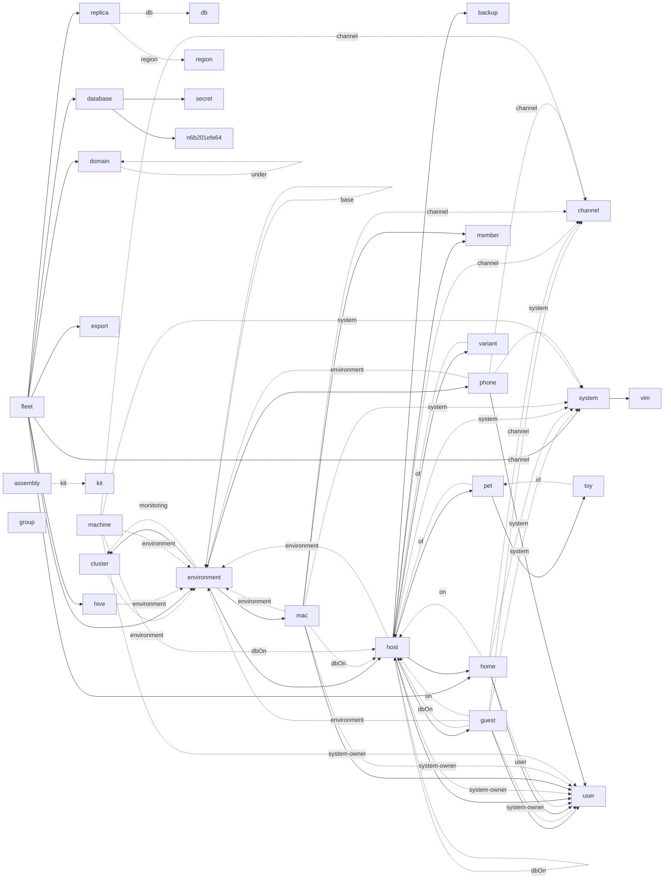

<details><summary>Sinks, pools, assemblies, vars, deploy order (diagrams)</summary>

**Sink forwarding**: a dashed edge is a sink key that feeds another sink (label: the kind). A solid edge is `out`, labelled with the receivers that build an output.

```mermaid
flowchart LR
  ncc24ba33bb("account")
  ne19ee6b5c8("age-secrets")
  n48d844d4c9("aspect-settings")
  ne6757dbb0b("backends")
  n964bca5c67("both")
  nfa20f4b2b6("certificate-domains")
  n427fbcd67e("checks")
  n51433b8bd8("ci")
  n2aba2b8d3f("class-members")
  nd71746440e("colmena")
  n5880016a7a("connect-claims")
  na4a7496f4e("darwin")
  n1da7acee50("db-claims")
  nf9ed027d00("deploy")
  nfaaefe0c2a("dev")
  n9e9018bb09("devshell")
  n2a8ec11140("dns-records")
  nc960dda0a1("dns-zones")
  nc319909949("droid")
  n58d5fbe670("exports")
  n5d2b151b79("files")
  n632ce41da4("flake-file")
  n2e96af1184("fw")
  neb8b81b71c("fw-tcp")
  n01947727a6("gateway-upstreams")
  n0b813f6126("generators")
  n1707fcb47d("git")
  n30e5c07625("git-hooks")
  n5f088b962b("globals")
  na3e05e4692("hmvals")
  n6c02586eb3("homeDarwin")
  nb4d870f4dd("homeLinux")
  n105bdfb4bb("homeManager")
  na03b519b92("host-addrs")
  n3e349132c7("idm-users")
  n2673d14998("inference-clients")
  nb1ac840462("infra")
  nc661e855c6("isNixos")
  n495c044323("k3s-nodes")
  n8fdd6c0ff0("k8s-manifests")
  n7f7e19d1fa("maid")
  n27f587449e("mesh-peers")
  n3bdc2ab4f7("meta")
  nb588cf97f7("monitor")
  nf2223a351e("monitoring-ingest")
  na788f0f454("nixos")
  n9ed1dd6a5f("no-gui")
  n58609270c8("nodes")
  na38fcc0344("os")
  nade7eca458("osConfig")
  nc03228363e("out")
  n305e8e949e("overlays")
  n81a4f97a16("packages")
  n3bd17f7e2f("pairs")
  n7c237af34c("peer-dev")
  n9608c364fa("persist")
  n24ae98cb28("platform")
  n70818b36fd("port-forwards")
  n44ee9b93c9("public-reads")
  n0a126f32d2("readme")
  n93bdf79f40("records")
  nf995268350("replicate-home")
  n9577e49d40("route-claims")
  n1170fc1994("scrape")
  n28498a499e("secret-claims")
  n7bec19a8d7("secrets")
  ndbaf8c5740("served-domains")
  nbc1be661db("service-domains")
  na57def2dad("syncthing-peers")
  nf4c1a72ce9("tags")
  nee15f964db("templates")
  n2b6100fe44("terraform")
  ncc06734691("terranix")
  n7376b1b127("token-claims")
  nae8f8b3768("treefmt")
  n3b0a85f662("tuning")
  n2306021a40("unfree")
  n635f763452("unifi")
  nfc2a3dde19("unit-checks")
  n40ab2ba9bb("user-packages")
  n54328a6510("vars")
  n9d0b46520b("vimrc")
  ne2b781d168("xmsg-nodes")
  n4218c12206[("flake outputs")]
  na788f0f454 -.->|"backup"| na788f0f454
  ne19ee6b5c8 -.->|"cluster"| n8fdd6c0ff0
  n8fdd6c0ff0 -->|"axon"| n4218c12206
  n2b6100fe44 -->|"prod"| n4218c12206
  ncc06734691 -->|"prod"| n4218c12206
  n635f763452 -->|"prod"| n4218c12206
  na38fcc0344 -->|"alice-laptop, alice@stage, app-1, app-2, app-3, app-4, +8"| n4218c12206
  n51433b8bd8 -->|"main"| n4218c12206
  nd71746440e -->|"main"| n4218c12206
  n632ce41da4 -->|"main"| n4218c12206
  n0b813f6126 -->|"main"| n4218c12206
  nb1ac840462 -->|"main"| n4218c12206
  n9577e49d40 -.->|"fleet"| n5880016a7a
  n9577e49d40 -.->|"fleet"| n28498a499e
  nee15f964db -->|"main"| n4218c12206
  nfc2a3dde19 -->|"main"| n4218c12206
  n40ab2ba9bb -->|"main"| n4218c12206
  n54328a6510 -->|"main"| n4218c12206
  ne19ee6b5c8 -.->|"guest"| na788f0f454
  na788f0f454 -.->|"guest"| na788f0f454
  na38fcc0344 -.->|"guest"| na788f0f454
  n9608c364fa -.->|"guest"| na788f0f454
  n2306021a40 -.->|"guest"| na38fcc0344
  n3bdc2ab4f7 -->|"prod, staging"| n4218c12206
  n105bdfb4bb -->|"alice, alice-laptop, alice@stage, bob, pixel"| n4218c12206
  ne19ee6b5c8 -.->|"host"| na788f0f454
  n2e96af1184 -.->|"host"| neb8b81b71c
  na788f0f454 -.->|"host"| n2aba2b8d3f
  na788f0f454 -.->|"host"| nd71746440e
  na788f0f454 -->|"app-1, app-2, app-3, app-4, ci, debug, +6"| n4218c12206
  na38fcc0344 -.->|"host"| na788f0f454
  n9608c364fa -.->|"host"| na788f0f454
  n2306021a40 -.->|"host"| na38fcc0344
  na4a7496f4e -->|"studio"| n4218c12206
  na38fcc0344 -.->|"mac"| na4a7496f4e
  nc319909949 -->|"pixel"| n4218c12206
  n105bdfb4bb -.->|"phone"| nc319909949
  n427fbcd67e -->|"x86_64-linux"| n4218c12206
  n9e9018bb09 -->|"aarch64-darwin, aarch64-linux, x86_64-linux"| n4218c12206
  n5d2b151b79 -->|"x86_64-linux"| n4218c12206
  n30e5c07625 -.->|"system"| n9e9018bb09
  n30e5c07625 -->|"aarch64-darwin, aarch64-linux, x86_64-linux"| n4218c12206
  n9ed1dd6a5f -->|"x86_64-linux"| n4218c12206
  n81a4f97a16 -->|"aarch64-darwin, aarch64-linux, x86_64-linux"| n4218c12206
  nae8f8b3768 -->|"aarch64-darwin, aarch64-linux, x86_64-linux"| n4218c12206
  ncc24ba33bb -.->|"user"| na38fcc0344
  ne19ee6b5c8 -.->|"user"| n105bdfb4bb
  n964bca5c67 -.->|"user"| n105bdfb4bb
  n964bca5c67 -.->|"user"| na38fcc0344
  n1707fcb47d -.->|"user"| n105bdfb4bb
  n6c02586eb3 -.->|"user"| n105bdfb4bb
  nb4d870f4dd -.->|"user"| n105bdfb4bb
  n105bdfb4bb -.->|"user"| na38fcc0344
  n7f7e19d1fa -.->|"user"| na38fcc0344
  n7bec19a8d7 -.->|"user"| n105bdfb4bb
  na788f0f454 -.->|"variant"| na788f0f454
  n9d0b46520b -->|"dev, min"| n4218c12206
```

**Pools**: elements routed up from one kind to another, labelled with the sinks.

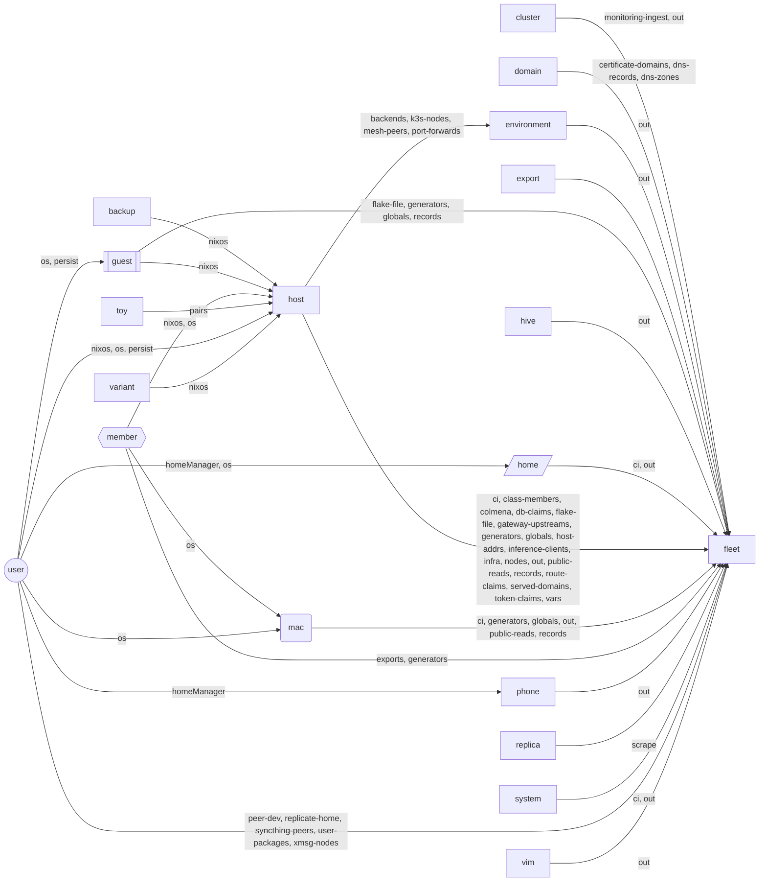

**Pool sequence**: the same pools as messages.

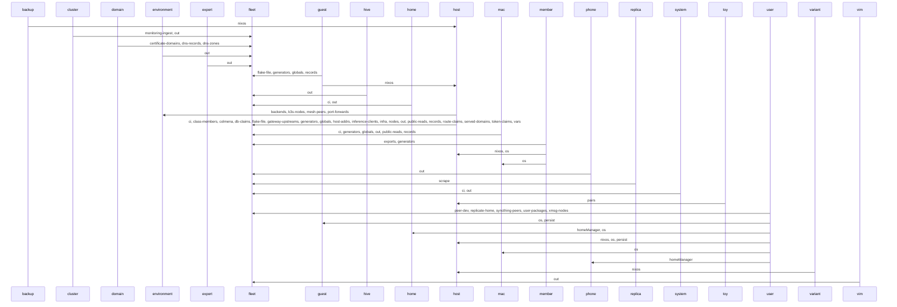

**assemblies**: each assembly (its kit) to the machines of each role.

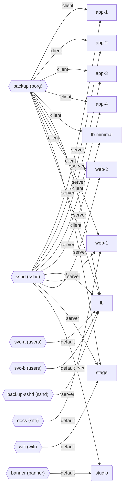

**vars generators**: an edge is a dependency. A hexagon is shared by every machine that uses it.

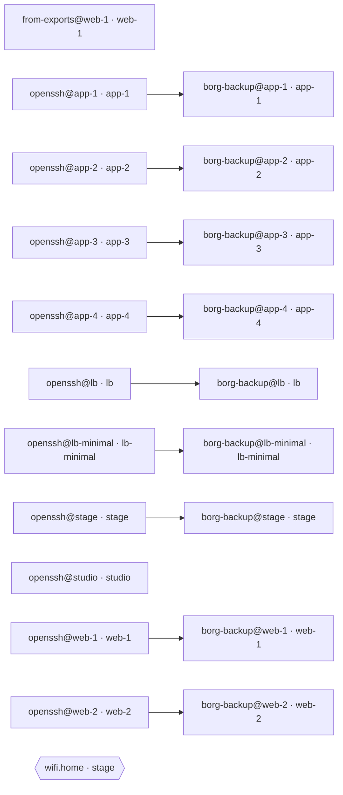

**Deploy order** (`dependsOn`).

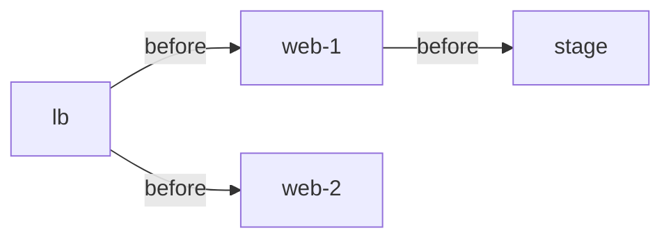

</details>

### Summary
| Environment | Machines | Users | Clusters |
|---|---|---|---|
| `lab` | app-1, app-2, app-3, app-4 | 0 |  |
| `prod` | lb, lb-minimal, web-1, web-2 | 1 | axon |
| `staging` | ci, stage, studio | 2 |  |

| Machine | Kind | Aspects giving elements | Some aspects |
|---|---|---|---|
| `app-1` | host | 32 | alloy, base, ci-host, db-lockdown, db-provide, deploy-record, +26 |
| `app-2` | host | 32 | alloy, base, ci-host, db-lockdown, db-provide, deploy-record, +26 |
| `app-3` | host | 32 | alloy, base, ci-host, db-lockdown, db-provide, deploy-record, +26 |
| `app-4` | host | 31 | alloy, base, ci-host, db-lockdown, db-provide, deploy-record, +25 |
| `lb` | host | 50 | alloy, attic, base, caddy, ci-host, db-lockdown, +44 |
| `lb-minimal` | host | 31 | alloy, base, deploy-record, dev, env-tuning, facter, +25 |
| `web-1` | host | 48 | alloy, api-route, base, ci-host, db-claim, db-client, +42 |
| `web-2` | host | 46 | alloy, autoinclude, base, ci-host, db-claim, db-client, +40 |
| `stage` | host | 53 | alloy, base, ci-host, db-claim, db-client, db-lockdown, +47 |
| `ci` | guest | 12 | alloy, base, dev, docker, global-pkgs, globals-addr, +6 |
| `studio` | mac | 13 | base, ci-mac, darwin-base, darwin-primary-user, dev, dock, +7 |

| Sink | Given at | Received at | Elements |
|---|---|---|---|
| `account` | user | user | 19 |
| `age-secrets` | host | host | 1 |
| `aspect-settings` | host | host | 9 |
| `backends` | host | environment | 3 |
| `both` | user | user | 2 |
| `certificate-domains` | domain | fleet | 3 |
| `checks` | system | system | 1 |
| `ci` | home, host, mac, system | fleet | 14 |
| `class-members` | host | fleet | 9 |
| `colmena` | host | fleet | 9 |
| `connect-claims` | fleet | fleet | 1 |
| `darwin` | mac | mac | 5 |
| `db-claims` | host | fleet | 3 |
| `deploy` | host | host | 9 |
| `dev` | host | host | 1 |
| `devshell` | system | system | 6 |
| `dns-records` | domain | fleet | 1 |
| `dns-zones` | domain | fleet | 2 |
| `droid` | phone | phone | 1 |
| `exports` | member | fleet | 2 |
| `files` | system | system | 2 |
| `flake-file` | fleet, guest, host | fleet | 14 |
| `fw` | host | host | 2 |
| `fw-tcp` | host | host | 1 |
| `gateway-upstreams` | host | fleet | 1 |
| `generators` | guest, host, mac, member | fleet | 31 |
| `git` | user | user | 26 |
| `git-hooks` | system | system | 3 |
| `globals` | guest, host, mac | fleet | 10 |
| `hmvals` | user | user | 10 |
| `homeDarwin` | user | user | 2 |
| `homeLinux` | user | user | 9 |
| `homeManager` | user | home, phone, user | 132 |
| `host-addrs` | host | fleet | 9 |
| `idm-users` | environment | environment | 3 |
| `inference-clients` | host | fleet | 1 |
| `infra` | host | fleet | 11 |
| `isNixos` | host | host | 9 |
| `k3s-nodes` | host | environment | 2 |
| `k8s-manifests` | cluster | cluster | 4 |
| `maid` | user | user | 4 |
| `mesh-peers` | host | environment | 8 |
| `meta` | hive | hive | 2 |
| `monitor` | host | host | 1 |
| `monitoring-ingest` | cluster | fleet | 1 |
| `nixos` | backup, guest, host, member, user, variant | backup, guest, host, variant | 230 |
| `no-gui` | system | system | 1 |
| `nodes` | host | fleet | 1 |
| `os` | export, guest, host, mac, member, user | export, guest, home, host, mac | 113 |
| `osConfig` | host | host | 9 |
| `out` | cluster, environment, export, fleet, hive, home, +5 | fleet | 57 |
| `overlays` | fleet | fleet | 1 |
| `packages` | system | system | 7 |
| `pairs` | host, toy | host | 6 |
| `peer-dev` | user | fleet | 9 |
| `persist` | guest, host, user | guest, host | 14 |
| `platform` | host | host | 9 |
| `port-forwards` | host | environment | 1 |
| `public-reads` | host, mac | fleet | 10 |
| `readme` | system | system | 7 |
| `records` | guest, host, mac | fleet | 11 |
| `replicate-home` | user | fleet | 9 |
| `route-claims` | host | fleet | 1 |
| `scrape` | replica | fleet | 1 |
| `secret-claims` | fleet | fleet | 1 |
| `secrets` | user | user | 16 |
| `served-domains` | host | fleet | 2 |
| `service-domains` | host | host | 2 |
| `syncthing-peers` | user | fleet | 9 |
| `tags` | host | host | 3 |
| `templates` | fleet | fleet | 1 |
| `terraform` | environment | environment | 1 |
| `terranix` | environment | environment | 1 |
| `token-claims` | host | fleet | 2 |
| `treefmt` | system | system | 3 |
| `tuning` | host | host | 14 |
| `unfree` | host | host | 1 |
| `unifi` | environment | environment | 1 |
| `unit-checks` | fleet | fleet | 1 |
| `user-packages` | user | fleet | 9 |
| `vars` | fleet, host | fleet | 10 |
| `vimrc` | vim | vim | 5 |
| `xmsg-nodes` | user | fleet | 13 |

## Capability index (generated)

Every list below is computed from the engine and this fleet when the README is written.

**Queries on an eval result** (`result = yen.lib.eval module`): `active`, `ask`, `check`, `context`, `data`, `declaredIn`, `errors`, `explain`, `facts`, `flake`, `floor`, `graph`, `impact`, `labels`, `queries`, `reduced`, `root`, `schema`, `scopes`, `undefined`.

**Engine library** (`yen.lib`): `agent`, `allowed`, `asOf`, `batteries`, `derive`, `diffData`, `eval`, `grant`, `history`, `is`, `jsonSafe`, `listOf`, `maybe`, `mkFlake`, `narrow`, `opt`, `secret`, `stage`, `validAt`, `without`.
Reduce strategies: `entries`, `flat`, `list`, `merge`, `one`, `set`. Change programs (`yen.lib.program`): `dryRun`, `opErrors`, `render`, `toModule`, `validate`. Grants: `allowed`, `grant`, `narrow`.

| Library | Functions |
|---|---|
| `yen.lib.graphs` | `cycles`, `fromEdges`, `layers`, `nodesOf`, `paths`, `reach`, `reachers`, `sccs`, `shortest`, `topo`, `transpose` |
| `yen.lib.datalog` | `certify`, `checkCertificate`, `comparisons`, `facts`, `ground`, `groundWith`, `isVar`, `judge`, `proof`, `stable`, `wfs`, `why`, `whyNot` |
| `yen.lib.krn` | `appendo`, `conde`, `conj`, `cons`, `disj`, `distinctfd`, `dom`, `eq`, `facto`, `fail`, `fdBound`, `fresh`, `freshNamed`, `fromList`, `infd`, `label`, `lefd`, `ltfd`, `maxOf`, `maximize`, `membero`, `minOf`, `neq`, `neqfd`, `nil`, `plusfd`, `project`, `propagator`, `run`, `runAll`, `runAllFuel`, `runC`, `runFuel`, `succeed`, `toList`, `unify`, `var`, `walkStar` |
| `yen.lib.rdf` | `ntriples`, `shacl`, `share`, `triples` |

**Stored queries** (`result.ask name args`):

| Query | Required | Optional | File |
|---|---|---|---|
| `aspectsOn` | `host` |  | queries.nix |
| `errorsBy` |  | `code` | queries.nix |
| `freePort` | `host` |  | synthesis.nix |
| `hostsIn` | `env` |  | queries.nix |
| `installOrder` | `assembly` |  | queries.nix |
| `placeDb` | `host` |  | synthesis.nix |
| `safeHostsFor` | `aspect`, `env` |  | synthesis.nix |

**Invariants** (`result.check`): `attic`, `base`, `db-exists`, `db-same-env`, `ssh`, `trust-order`, `unique-addr`, `vocabulary`.

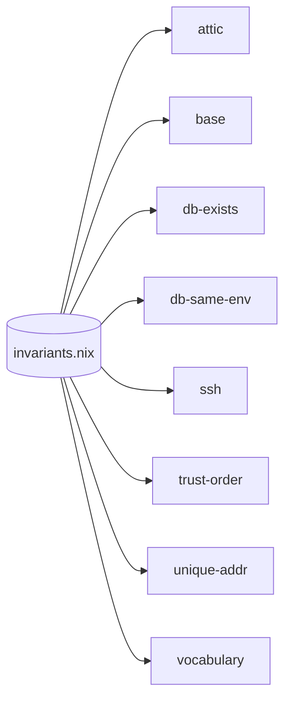

**MCP tools** (14): `yen_ask`, `yen_check`, `yen_context`, `yen_declared_in`, `yen_errors`, `yen_explain`, `yen_export`, `yen_impact`, `yen_labels`, `yen_program`, `yen_queries`, `yen_schema`, `yen_stage`, `yen_why_not`.

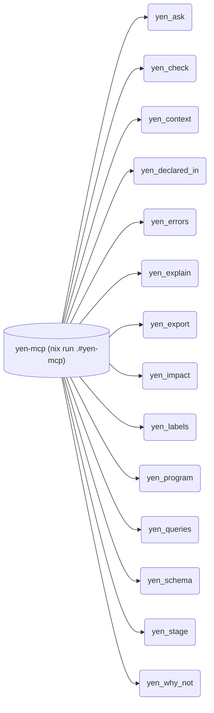

**Labels** (`yen.labels`, by file path): `agent/` trust 1, `modules/` trust 3. Aspects declared under `agent/` and the elements they give (`result.floor 3`):

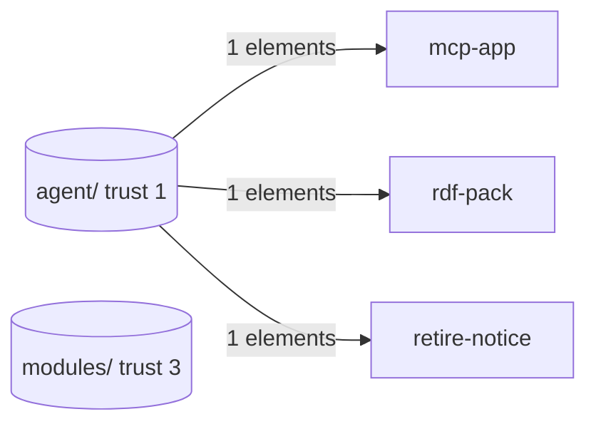

**Performance levers.** Shared pkgs (`sharedPkgs`): `app-1`, `app-2`, `app-3`, `lb`, `web-1`, `web-2`. Trimmed module lists (`trimmedModules`): `app-2`, `web-1`.

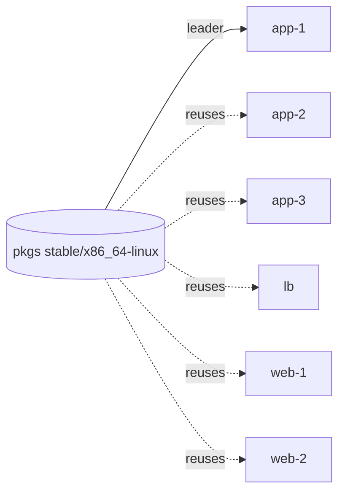

**Research and pattern maps** (in `vic/` of the yen repository): `ai-infra-research.md`, `clan-patterns.txt`, `den-census.md`, `den-patterns.md`, `design.md`, `evalmodules-research.md`, `gen-query-research.txt`, `hoag-ci-patterns.txt`, `modlist-research.md`, `quipu-lessons.md`, `sini-patterns.md`.

### CI jobs (`ci.json`)
| Job | System | Builds |
|---|---|---|
| `alice-laptop` | `x86_64-linux` | `homeConfigurations."alice-laptop".activationPackage` |
| `alice@stage` | `x86_64-linux` | `homeConfigurations."alice@stage".activationPackage` |
| `app-1` | `x86_64-linux` | `nixosConfigurations.app-1.config.system.build.toplevel` |
| `app-2` | `x86_64-linux` | `nixosConfigurations.app-2.config.system.build.toplevel` |
| `app-3` | `x86_64-linux` | `nixosConfigurations.app-3.config.system.build.toplevel` |
| `app-4` | `x86_64-linux` | `nixosConfigurations.app-4.config.system.build.toplevel` |
| `devshell-aarch64-darwin` | `aarch64-darwin` | `devShells.aarch64-darwin.default` |
| `devshell-aarch64-linux` | `aarch64-linux` | `devShells.aarch64-linux.default` |
| `devshell-x86_64-linux` | `x86_64-linux` | `devShells.x86_64-linux.default` |
| `lb` | `x86_64-linux` | `nixosConfigurations.lb.config.system.build.toplevel` |
| `stage` | `x86_64-linux` | `nixosConfigurations.stage.config.system.build.toplevel` |
| `studio` | `aarch64-darwin` | `darwinConfigurations.studio.config.system.build.toplevel` |
| `web-1` | `x86_64-linux` | `nixosConfigurations.web-1.config.system.build.toplevel` |
| `web-2` | `x86_64-linux` | `nixosConfigurations.web-2.config.system.build.toplevel` |
